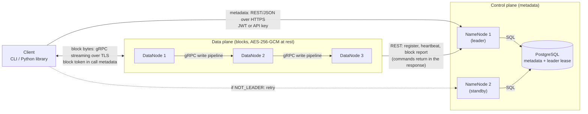
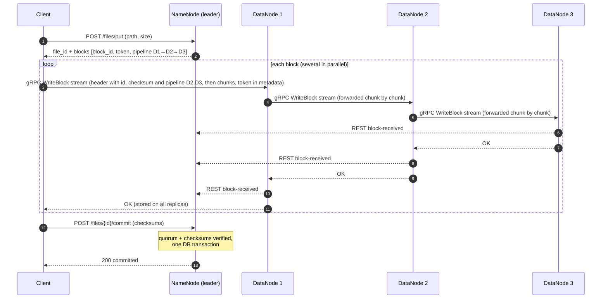

# DFSha — Architecture and Design Decisions (v0.2)

Companion of [`API.md`](API.md) (the contract). This document explains **why** the system is built this way, how it meets each requirement, how it will be tested and demonstrated, and which rubric criteria each part supports.

---

## 1. Service definition

**Problem.** Store and retrieve large files across several machines so that no single machine failure loses data or stops the service, with controlled access and encrypted data.

**Service.** DFSha is a **block-based distributed file system** in the style of HDFS:

- Files are split into fixed-size **blocks**; blocks of one file are spread across different **DataNodes**, and every block is **replicated** (factor 3 by default).
- A **NameNode** (ControlNode) holds all metadata: namespace, permissions, which blocks make up a file, and where each replica lives.
- A **Client** (CLI + Python library) gives a hierarchical, Linux-like view (`ls`, `cd`, `mkdir`, `put`, `get`, …).
- Files are **WORM** (write-once-read-many), like HDFS.

**Assigned option: Option 1 — Client/Server** with the server implemented by composition and distribution (NameNodes + DataNodes + metadata database) inside a private network, exposing open APIs to clients (REST for metadata, gRPC for blocks). Architecture type: **Master–Workers** (HDFS-like).

**Functional requirements covered:** RF1 (file system management), RF2 (transfer: `put`/`get`), RF3 (access: `open`/`close`/`read`/`lock`, and block-level read/write APIs), plus the professor's "basic read/write APIs on files (blocks) from the client".

**Non-functional requirements:** scalability, high availability, consistency, partitioning, performance (concurrency), security (communications, storage, access control, node-to-node), transparency.

---

## 2. Architecture



| Interaction | Protocol | Notes |
|---|---|---|
| Client ↔ NameNode | REST/JSON over HTTPS | Metadata only; JWT or API key |
| Client ↔ DataNode | **gRPC** (HTTP/2 + Protocol Buffers) over TLS | Block read/write, streamed in chunks; block token in call metadata |
| DataNode ↔ DataNode | **gRPC** over TLS | Write pipeline and re-replication, forwarded chunk by chunk |
| DataNode → NameNode | REST/JSON over HTTPS | Register, heartbeat, block report; commands come back in the response |
| NameNode ↔ NameNode | Via PostgreSQL lease row | No direct channel needed |
| NameNode ↔ PostgreSQL | SQL | Private network only |

**Why REST for metadata and control.** Allowed by the statement, FastAPI generates the OpenAPI documentation, and every interface is testable with `curl`. Those messages are small and infrequent, so REST's overhead does not matter and its debuggability does.

**Why gRPC for blocks.** That channel carries the large transfers. gRPC (HTTP/2 + Protocol Buffers) streams a block in chunks, so a DataNode can forward data to the next node of the pipeline while it is still receiving it, instead of waiting for the whole block. It also multiplexes several transfers over one connection and gives a strict, generated contract (`.proto`). The statement lists gRPC as an accepted option. Trade-offs: it is harder to debug than `curl` (`grpcurl` with server reflection is used instead), the build needs a stub-generation step, and the project has two stacks (REST and gRPC) to integrate.

**Why "DataNodes call the NameNode".** Same pattern as HDFS: the NameNode never needs to reach a DataNode, so it works behind NAT/firewalls and keeps the NameNode simple.

---

## 3. Key flows

**Write (`put`).**
1. Client → NameNode: `put(path, size)`. NameNode checks permissions, reserves the path, splits the file into blocks, chooses a **pipeline** of DataNodes per block, and returns block ids, tokens and pipelines.
2. Client streams each block (in parallel, in chunks) to the first DataNode of its pipeline over gRPC; the DataNode forwards the chunks to the next node as they arrive, verifies the checksum, stores the block (encrypted at rest) and reports `block-received` to the NameNode (REST).
3. Client → NameNode: `commit` with checksums. NameNode verifies that every block has ≥ `MIN_REPLICAS_COMMIT` confirmed replicas and the checksums match, then makes the file visible in **one transaction**.

**Read (`get`).**
1. Client → NameNode: `get(path)`. Gets blocks, checksums, read tokens and the list of **live** replicas.
2. Client downloads blocks in parallel from any replica, falling back to another on failure; verifies each checksum and the optional whole-file checksum; joins them in order.

**Failure handling (re-replication).**
1. A DataNode stops sending heartbeats ⇒ after `DEAD_NODE_TIMEOUT_S` the NameNode marks it dead.
2. A background loop finds blocks with fewer live replicas than the target and adds `replicate` commands to the heartbeat responses of nodes holding a good copy.
3. Those nodes copy the block to a new node; `block-received` updates the replica map until the target is restored.


**Sequence of a write (`put`).**



---

## 4. Replication and consistency model

| Aspect | Decision |
|---|---|
| **Data model** | WORM: blocks and committed files are immutable. This removes the update-conflict problem entirely. |
| **Metadata consistency** | **Strong.** One leader NameNode; all metadata changes are ACID transactions in PostgreSQL. |
| **Write quorum** | A file becomes visible only if every block has ≥ `MIN_REPLICAS_COMMIT` (2 of 3) **confirmed** replicas and checksums match. |
| **Read** | From any live replica (R = 1): safe because blocks are immutable and checksum-verified. No read-your-writes anomalies: a file is invisible until `commit`. |
| **Atomic visibility** | `commit` is one DB transaction. A reader sees the complete file or nothing. Overwrite swaps the path to the new version in one transaction; old blocks are garbage-collected afterwards. |
| **Replica convergence** | Eventual: heartbeats + block reports + re-replication restore the target count; surplus replicas are deleted; orphan blocks are removed. |
| **Integrity** | SHA-256 per block (verified by DataNode on write, by client on read) + optional whole-file checksum + GCM authentication tag on every read from disk. Corrupt replicas are detected, discarded and re-created. |
| **Concurrency** | One writer per path (upload reservation, `UPLOAD_IN_PROGRESS`); unlimited concurrent readers; optional `shared`/`exclusive` locks with automatic expiry. |
| **Idempotency** | `WriteBlock`, `commit` and `abort` are idempotent, so client retries are safe. |

**Failure scenarios and outcome**

| Failure | Outcome |
|---|---|
| DataNode dies during a read | Client falls back to another replica; no error for the user |
| DataNode dies during a write | Pipeline continues with the remaining nodes; `commit` succeeds if the quorum is met, otherwise the client retries the block with a fresh pipeline (`/tokens`) |
| DataNode dies permanently | Blocks re-replicated onto other nodes; `under_replicated_blocks` returns to 0 |
| DataNode returns after a long absence | Its block report reveals stale/surplus replicas; surplus ones are deleted |
| Client dies mid-upload | Reservation expires after `UPLOAD_TTL_S`; reserved blocks are garbage-collected |
| Block corrupted on disk | Detected on read (tag/checksum) or by report; replica discarded and re-created |
| Leader NameNode dies | Standby acquires the lease within about `LEASE_S`; clients/DataNodes retry on the new leader; uploads in flight survive |
| Zombie (stale) leader | DataNodes ignore commands with a lower `term` (fencing) |
| PostgreSQL unavailable | Metadata operations fail with `503`; **stated limitation**, mitigated by a replica (stretch goal) |

---

## 5. Scalability design

| Dimension | How DFSha scales / what limits it |
|---|---|
| **Storage capacity & throughput** | Add DataNodes: they register themselves and receive new blocks (most-free-space placement). Clients move bytes **directly** to/from DataNodes, so aggregate throughput grows with the number of nodes. |
| **File size** | Files are split into blocks; blocks are placed independently. Bound: `MAX_FILE_SIZE_BYTES` because `put` allocates all blocks up front (documented; incremental allocation is a future improvement). |
| **Number of files** | Metadata in PostgreSQL with indexes on `(parent_id, name)`; `ls` is paginated. Rough order of magnitude: 1 PB at 64 MB blocks ≈ 16 million block rows — manageable for PostgreSQL. |
| **Number of users** | The NameNode is stateless apart from the database; per-request work is small (no data passes through it). Block tokens are validated by DataNodes locally, with no NameNode round trip. |
| **Concurrency** | Parallel block transfers in the client; concurrent readers and writers on different paths; multithreaded/async FastAPI services. |
| **Control-plane load** | Heartbeats are tiny; block reports are periodic; commands piggyback on responses. |
| **Known bottleneck & path forward** | The leader NameNode (single writer of metadata). Next steps: read-only standby serving, namespace partitioning (federation by path prefix), read replicas of the database. Mentioned in the report as future work. |

---

## 6. Security design

| Threat / requirement | Control |
|---|---|
| Eavesdropping on any hop | TLS on every channel |
| Stolen disks / DataNode host compromise | AES-256-GCM at rest, per-block key via HKDF from a master key kept in environment/secret store |
| Unauthenticated users | Passwords hashed with bcrypt/argon2; JWT with expiry; API keys (hashed, revocable) |
| Unauthorized file access | Owner + ACL per user **or group**, checked on every operation and before issuing tokens |
| Direct access to DataNodes | Block tokens (HMAC-signed, bound to block id + operation + user, short TTL) sent as gRPC call metadata and validated locally in a server interceptor |
| Rogue DataNode / forged control messages | `X-Node-Key` required for register/heartbeat/reports; stale-leader commands ignored via `term` |
| Tampering / corruption | Checksums + GCM tag |
| Accountability | Audit log of authentication and FS operations with request ids |
| Network exposure | Security groups: PostgreSQL reachable only from NameNodes; NameNode REST port and DataNode gRPC port exposed to clients; no other ports |
| Stretch goals | TOTP 2FA, per-node keys, mutual TLS, login rate limiting, client-side encryption |

---

## 7. Metadata schema (PostgreSQL)

| Table | Main columns |
|---|---|
| `users` | id, username (unique), password_hash, role (`user`/`admin`), created_at |
| `api_keys` | id, user_id, name, key_hash, created_at, revoked_at |
| `groups`, `group_members` | name, owner_id · group, user_id |
| `inodes` | id, parent_id, name, type (`file`/`dir`), owner_id, current_file_id, created_at, modified_at · **unique (parent_id, name)** |
| `files` | file_id (uuid), inode_id, size, block_size, replication, status (`pending`/`committed`), checksum, upload_expires_at |
| `blocks` | block_id, file_id, idx, size, checksum |
| `block_replicas` | block_id, node_id, state, reported_at |
| `datanodes` | node_id, internal_addr, public_addr, capacity, used, last_heartbeat, state |
| `acls` | inode_id, subject (`user:x` / `group:y`), permission |
| `locks` | lock_id, inode_id, owner_id, mode, expires_at |
| `pending_deletes` | block_id, node_id |
| `leader` | holder, url, term, lease_expires_at (single row) |
| `audit_log` | ts, user, operation, path, result, request_id |

---

## 8. Execution environment

- Every node runs **natively or in Docker**; each exposes an API (statement requirement).
- **Local cluster:** `docker-compose.yml` with `postgres`, `namenode1`, `namenode2`, `datanode1..3` (optionally `datanode4` to show scaling) and a `client` container. Demo profile: `BLOCK_SIZE=1MB`.
- **Cloud (AWS Academy / GCP academic), suggested topology:**

| VM | Runs | Ports |
|---|---|---|
| vm1 | NameNode 1 + PostgreSQL | 8000 (REST: clients and DataNodes), 5432 (**only from NameNodes**) |
| vm2 | NameNode 2 | 8000 (REST) |
| vm3, vm4, vm5 | DataNode 1, 2, 3 | 9000 (gRPC: clients and other DataNodes) |

- Configuration through environment variables only (`.env.example` in the repo); secrets never committed.
- The gRPC stubs of the block service are generated from the `.proto` at build time (`grpcio` / `grpcio-tools`) and are not committed; the Docker images of the client and the DataNodes include that step.

**Suggested repository layout**

```
dfsha/
├── README.md              # how to run everything + links
├── API.md                 # contract
├── ARCHITECTURE.md        # this file
├── AGENTS.md / CLAUDE.md  # context for AI assistants (short!)
├── docker-compose.yml
├── .env.example
├── proto/                 # .proto of the block service (gRPC), added by the DataNode owner
├── namenode/  datanode/  client/  common/ (shared models, token utils)
└── tests/                 # integration + failure scenarios
```

---

## 9. Performance and scalability evidence to collect

| Experiment | What to measure | Why it matters |
|---|---|---|
| Upload/download of 100 MB–1 GB with 1, 2, 4, 8 parallel transfers | Throughput (MB/s) | Concurrency and parallel block transfer |
| Same file with 1 vs 3 vs 4 DataNodes | Throughput and block distribution | Scalability by adding nodes |
| Block size 1 MB vs 4 MB vs 64 MB | Throughput, metadata size | Justifies the default |
| gRPC chunk size 256 KiB vs 1 MiB vs 2 MiB | Throughput, CPU | Tunes the streaming of blocks |
| Replication overhead: factor 1 vs 3 | Write time | Cost of availability |
| NameNode metadata ops: `ls`/`stat`/`mkdir` under N concurrent clients | Requests/s and latency | Control-plane capacity |
| Time to restore replication after killing a DataNode | Seconds | Availability/recovery |
| Time to failover after killing the leader | Seconds and failed requests | HA |

Keep raw numbers and a simple chart for the report.

---

## 10. Test plan (also the demo script)

| # | Scenario | Expected result | Rubric criterion |
|---|---|---|---|
| T1 | `put` a 100 MB random file then `get` it; compare SHA-256 | Identical | Replication & consistency |
| T2 | Inspect block placement with `/v1/admin/blocks/{id}` | Blocks of one file on different nodes; 3 replicas each | Design, scalability |
| T3 | Kill a DataNode during `get` | Download completes via other replicas | Availability |
| T4 | Kill a DataNode; watch `/v1/admin/stats` | `under_replicated_blocks` rises, then returns to 0 | Availability, replication |
| T5 | Kill the leader NameNode during a transfer | Standby becomes leader in ~`LEASE_S`; operations resume; data intact | Availability |
| T6 | Corrupt a block file on a DataNode's disk, then read it | Corruption detected; read served from another replica; replica repaired | Consistency |
| T7 | Two clients `put` the same path | One succeeds, the other gets `409 UPLOAD_IN_PROGRESS` | Consistency |
| T8 | Overwrite a file while another client reads the old version | Reader sees a complete version, never a mix | Consistency |
| T9 | User B reads user A's file → `403`; after `acl` for B or B's group → allowed | Access control by user and group | Security |
| T10 | Use a block token for another block, an expired token, or no token | `UNAUTHENTICATED` / `PERMISSION_DENIED` (gRPC) | Security |
| T11 | Search a DataNode's storage directory for known plaintext | Not found (encrypted at rest) | Security |
| T12 | Capture traffic or show TLS on the REST and gRPC channels | No plaintext on the wire | Security |
| T13 | Register a new DataNode and upload more files | New blocks placed on the new node | Scalability |
| T14 | Exclusive lock by A; B tries to read/remove | `423 LOCKED`; lock expires automatically | RF3 / concurrency |
| T15 | Throughput experiments of Section 9 | Table and chart | Scalability / performance |

---

## 11. Demo video plan (10–15 min)

| Minutes | Content |
|---|---|
| 0:00–1:30 | Problem, option 1, architecture diagram, components and protocols |
| 1:30–4:30 | CLI tour: login, `mkdir`, `put`, `ls`, `get`, checksum comparison; show block distribution and replicas (T1, T2) |
| 4:30–7:00 | DataNode failure: read still works, re-replication restored (T3, T4) |
| 7:00–8:30 | NameNode failover (T5) |
| 8:30–10:30 | Security: users/groups/ACL, API key, block tokens, encryption at rest, TLS (T9–T12) |
| 10:30–12:30 | Concurrency and consistency: T7, T8, T14; integrity T6 |
| 12:30–14:00 | Scalability: add a DataNode (T13) and the performance chart (T15) |
| 14:00–15:00 | Limitations, future work, repository tour |

Tips: rehearse once, keep a pre-recorded backup of the slowest steps, use the demo profile (1 MB blocks) so a small file visibly produces many blocks, and show `/v1/admin/stats` on screen during failures.

---

## 12. Rubric coverage checklist

| Criterion (weight) | Where it is addressed | Evidence to show |
|---|---|---|
| **1. Service definition and architectural design (15%)** | §1, §2, §3, §7, §8 of this file; `API.md` §0 | Requirement mapping table, architecture diagram, flows, schema |
| **2. Communications specifications (15%)** | `API.md` (all sections), §2 here | Documented interfaces for client↔NN, client↔DN, DN↔DN, NN↔DN, NN↔NN; OpenAPI at `/docs` (REST) and the `.proto` (gRPC block service); error model with HTTP and gRPC status mapping; examples |
| **3. Scalability design (15%)** | §5, §9 here; `API.md` §5.1, §7 (placement, pagination) | T13, T15, charts, honest bottleneck analysis |
| **4. High availability (15%)** | §4 (failure table), §3, `API.md` §7, §9 | T3, T4, T5 live |
| **5. Replication and data consistency (15%)** | §4 here; `API.md` §5.2, §5.4, §6 | T1, T6, T7, T8 |
| **6. Security (15%)** | §6 here; `API.md` §2, §4.1, §4.2 | T9–T12, audit log, code review of token validation |
| **7. Video and final report (10%)** | §10, §11 here | Video plan; report built from this file + test results; reproducible repository (`README`, `docker-compose`, `.env.example`) |

### Final report outline (from the deliverables list)

1. Objective and short theoretical framework (GFS, HDFS, block vs object storage)
2. Service description and problem
3. Architecture and diagrams (§2 and §3 here)
4. Protocol and API specification (`API.md`)
5. Partitioning and distribution algorithms (placement, pipeline, re-replication)
6. Execution environment (Docker, topology)
7. Tests and result analysis (§9, §10)
8. Limitations and future work

---

## 13. Known limitations (state them openly)

- PostgreSQL is a single point of failure unless a replica is added.
- The leader NameNode is the only writer of metadata (bottleneck at very large scale).
- `put` allocates all blocks up front; maximum file size is bounded.
- WORM only: no in-place partial updates.
- Client-side encryption, 2FA and mutual TLS are stretch goals.
- The block channel uses gRPC: it cannot be called from a browser or with plain `curl`, and debugging it needs `grpcurl` (with server reflection enabled in development).
- gRPC needs HTTP/2 end to end: any load balancer or proxy placed in front of the DataNodes must support it.
