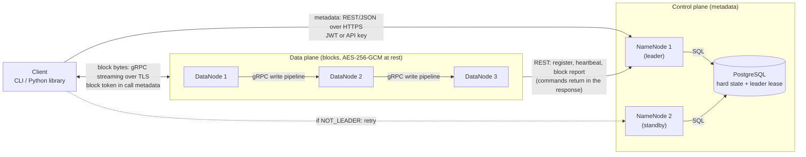
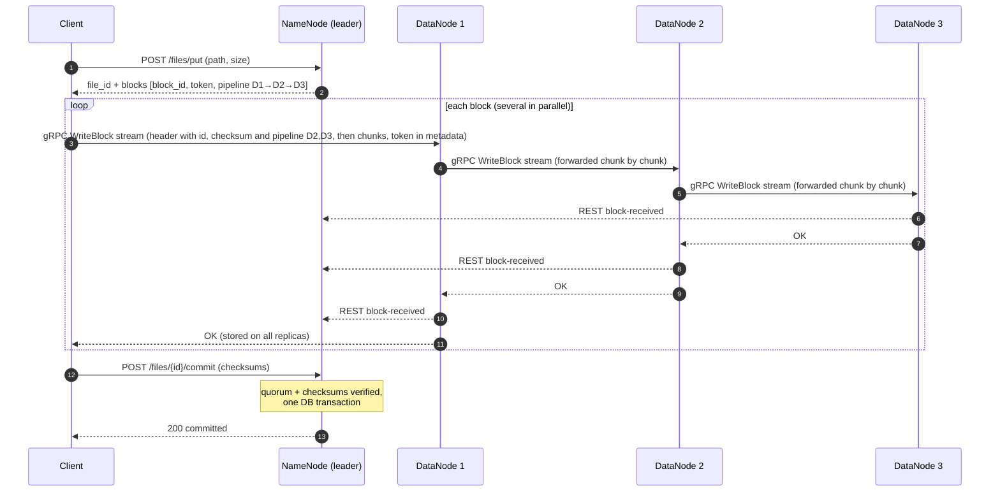
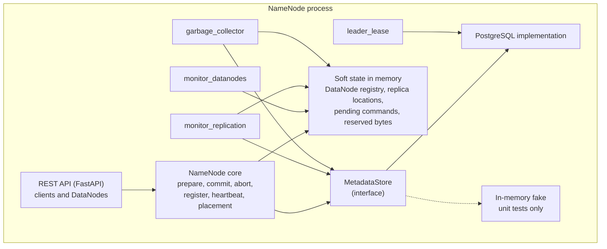
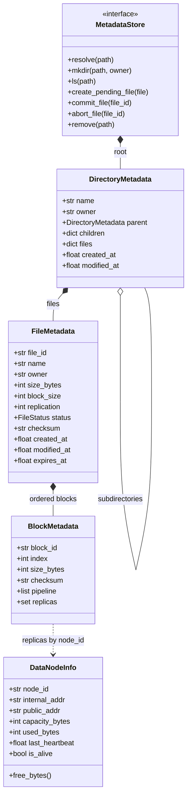

# DFSha — Architecture and Design Decisions (v0.6)

Companion of [`API.md`](API.md) (the contract, v0.8). This document explains **why** the system is built this way, how it meets each requirement, how it will be tested and demonstrated, and which rubric criteria each part supports.

Since v0.3 it also **unifies the NameNode design with the code already written**: Section 4 (NameNode internals), Section 5 (metadata model and state), Section 6 (algorithms) and Appendix A (what the current code already matches and what must change). The code-level reference for the data model is [`NAMENODE_MODELS.md`](NAMENODE_MODELS.md); the data plane implementation notes are in [`GRPC_BLOCK_SERVICE.md`](GRPC_BLOCK_SERVICE.md).

**v0.6** re-reads the project statement line by line against the design and folds in what testing the data plane revealed. Eight decisions moved, all recorded with their evidence in Section 16: the metadata store is replicated, the leader degrades to read-only instead of stepping down, node-to-node identity is mutual TLS, TOTP 2FA is required, the cluster needs more DataNodes than the replication factor, blocks are allocated in batches, a write pipeline skips a dead hop, and ranged block reads are a requirement.

---

## 1. Service definition

**Problem.** Store and retrieve large files across several machines so that no single machine failure loses data or stops the service, with controlled access and encrypted data.

**Service.** DFSha is a **block-based distributed file system** in the style of HDFS:

- Files are split into fixed-size **blocks**; blocks of one file are spread across different **DataNodes**, and every block is **replicated** (factor 3 by default).
- A **NameNode** (ControlNode) holds all metadata: namespace, permissions, which blocks make up a file, and where each replica lives.
- A **Client** (CLI + Python library) gives a hierarchical, Linux-like view (`ls`, `cd`, `mkdir`, `put`, `get`, …).
- Files are **WORM** (write-once-read-many), like HDFS.

**Assigned option: Option 1 — Client/Server** with the server implemented by composition and distribution (NameNodes + DataNodes + metadata database) inside a private network, exposing open APIs to clients (REST for metadata, gRPC for blocks). Architecture type: **Master–Workers** (HDFS-like).

**Functional requirements covered:** RF1 (file system management), RF2 (transfer: `put`/`get`), RF3 (access: `open`/`close`/`read`/`lock`, and block-level read/write APIs), plus the professor's "basic read/write APIs on files (blocks) from the client".

**Non-functional requirements:** scalability, high availability, consistency, partitioning, performance (concurrency), security (communications, storage, access control, node-to-node), transparency.

---

## 2. Architecture



High availability is part of the design from the start: two NameNodes (one leader, one standby) share one PostgreSQL database (Section 5.2).

| Interaction | Protocol | Notes |
|---|---|---|
| Client ↔ NameNode | REST/JSON over HTTPS | Metadata only; JWT or API key |
| Client ↔ DataNode | **gRPC** (HTTP/2 + Protocol Buffers) over TLS | Block read/write, streamed in chunks; block token in call metadata |
| DataNode ↔ DataNode | **gRPC** over TLS | Write pipeline and re-replication, forwarded chunk by chunk |
| DataNode → NameNode | REST/JSON over HTTPS, **mutual TLS** | Register, heartbeat, block report; commands come back in the response |
| NameNode ↔ NameNode | REST/JSON over HTTPS, **mutual TLS** | `/v1/ha/status` and `/v1/ha/stepdown`: role and `term` discovery, leader handover, degraded-mode reporting. Coordination of record still goes through the lease row, so the channel is never required for correctness |
| NameNode ↔ database | SQL over TLS | Private network only; only the primary is written (Section 5.2) |

The NameNode serves **REST only**; gRPC exists only on the DataNodes (block service).

**Why REST for metadata and control.** Allowed by the statement, FastAPI generates the OpenAPI documentation, and every interface is testable with `curl`. Those messages are small and infrequent, so REST's overhead does not matter and its debuggability does.

**Why gRPC for blocks.** That channel carries the large transfers. gRPC (HTTP/2 + Protocol Buffers) streams a block in chunks, so a DataNode can forward data to the next node of the pipeline while it is still receiving it, instead of waiting for the whole block. It also multiplexes several transfers over one connection and gives a strict, generated contract (`.proto`). The statement lists gRPC as an accepted option. Trade-offs: it is harder to debug than `curl` (`grpcurl` with server reflection is used instead), the build needs a stub-generation step, and the project has two stacks (REST and gRPC) to integrate.

**Why "DataNodes call the NameNode".** Same pattern as HDFS: the NameNode never needs to reach a DataNode, so it works behind NAT/firewalls and keeps the NameNode simple.

---

## 3. Key flows

**Write (`put`).**
1. Client → NameNode: `put(path, size)`. NameNode checks permissions, reserves the path (file in `PENDING` state), splits the file into blocks, chooses a **pipeline** of DataNodes per block, and returns block ids, tokens and pipelines.
2. Client streams each block (in parallel, in chunks) to the first DataNode of its pipeline over gRPC; the DataNode forwards the chunks to the next node as they arrive, verifies the checksum, stores the block (encrypted at rest) and reports `block-received` to the NameNode (REST).
3. Client → NameNode: `commit` with checksums. NameNode verifies that every block has ≥ `MIN_REPLICAS_COMMIT` **confirmed** replicas and the checksums match, then makes the file visible (`COMMITTED`) in **one transaction**.

**Read (`get`).**
1. Client → NameNode: `get(path)`. Gets blocks, checksums, read tokens and the list of **live** replicas.
2. Client downloads blocks in parallel from any replica, falling back to another on failure; verifies each checksum and the optional whole-file checksum; joins them in order.

**Failure handling (re-replication).**
1. A DataNode stops sending heartbeats ⇒ after `DEAD_NODE_TIMEOUT_S` the NameNode marks it dead.
2. A background loop finds blocks with fewer live replicas than the target and adds `replicate` commands to the heartbeat responses of nodes holding a good copy.
3. Those nodes copy the block to a new node; `block-received` updates the replica map until the target is restored.

**Sequence of a write (`put`).**



---

## 4. NameNode internals

### 4.1 Components



The core is a plain Python class with no web code, so it can be unit-tested with fake time and an in-memory store. The REST layer is a thin adapter on top of it.

### 4.2 Background tasks

| Task | Period | What it does | Rules |
|---|---|---|---|
| `api_server` | continuous | Serves the REST API for clients and DataNodes (FastAPI / uvicorn). **No gRPC on the NameNode.** | Handlers call the core; see 4.4 for concurrency |
| `monitor_datanodes` | 5 s | Marks a DataNode dead when it has sent no heartbeat for `DEAD_NODE_TIMEOUT_S` | Uses one monotonic clock; does nothing during `FAILOVER_GRACE_S` after a leader change |
| `monitor_replication` | 10 s | Compares live, confirmed replicas of each block with `REPLICATION_FACTOR`; queues `replicate` commands (too few) or `delete` commands (too many) | **Only blocks of `COMMITTED` files**; never blocks of uploads in progress. Skips blocks that already have a replication in flight (with a timeout) so a command is not queued twice |
| `garbage_collector` | 30 s | Expires `PENDING` uploads past `expires_at` (status `ABORTED`, their blocks queued for deletion); removes blocks of deleted or replaced files; handles orphan blocks found in block reports | Deletion is delivered as `delete` commands in heartbeat responses |
| `leader_lease` | `LEASE_S / 3` | The leader renews the lease and steps down if the renewal fails; the standby tries to acquire an expired lease | Runs in every NameNode |

### 4.3 Rules for the core operations

**`prepare_file_upload(path, size, owner, overwrite)`**
1. Validate the path (absolute, no `.` / `..`), that the parent directory exists and the caller may write in it, and `size ≤ MAX_FILE_SIZE_BYTES` (`FILE_TOO_LARGE`).
2. If the path has a non-expired `PENDING` upload → `UPLOAD_IN_PROGRESS`. If it has a `COMMITTED` file and `overwrite` is false → `ALREADY_EXISTS`; with `overwrite`, the old version keeps being served until the new commit.
3. Require at least `REPLICATION_FACTOR` live DataNodes, otherwise `NOT_ENOUGH_DATANODES`.
4. Split into blocks and choose a pipeline per block (Section 6). The pipeline is only the **allocation**; the block's `replicas` stay empty until DataNodes confirm.
5. Create the `FileMetadata` as `PENDING` with `expires_at = now + UPLOAD_TTL_S`. It is indexed by id and by path but **not visible** in directory listings.
6. Return the plan with a write token per block.

**`commit_file_upload(file_id, blocks, file_checksum)`**
1. The file must exist. If it is already `COMMITTED` with the same body, return success (idempotent). An `ABORTED` file cannot be committed.
2. All block indexes are present and the sizes add up to the declared `size`.
3. Every block has at least `MIN_REPLICAS_COMMIT` confirmed replicas on live nodes, and the checksum sent by the client equals the one the DataNodes reported.
4. In one transaction: store the block checksums, set `COMMITTED`, link the file in its directory (replacing the old version if `overwrite`, whose blocks are queued for deletion) and set `modified_at`.

**`register_datanode(node_id, internal_addr, public_addr, capacity, used)`**: creates or updates the registry entry; keeps the replica locations already known for that node. Returns the intervals and the current `term`.

**`record_heartbeat(node_id, free_bytes, used_bytes, active_transfers)`**: updates liveness **and free space** (so placement uses real numbers), clears reserved bytes that the heartbeat now covers, and returns `{ term, commands }` taken from the node's own command queue (replicate and delete).

**`block-received(node_id, block_id, size, checksum)`**: adds the node to the block's confirmed replicas and records the checksum it computed.

### 4.4 Time and concurrency rules

- **Clocks.** Liveness (`last_heartbeat`, timeouts) is in-memory and per process, so it uses **one** monotonic clock (`time.monotonic()`) everywhere. Anything that is stored or compared across processes or restarts (`created_at`, `modified_at`, `expires_at`, `lease_expires_at`) uses wall-clock UTC. The two are never subtracted from each other.
- **Concurrency.** Either every core call runs on the event loop (async handlers, no `await` inside a core method, so each call is atomic), or a single lock guards the store. Background tasks iterate over a **snapshot** (`list(d.values())`), never over a dictionary that another call may be changing.

---

## 5. Metadata model and state

### 5.1 Hard state and soft state

The NameNode's information is split in two, as in HDFS:

| | Hard state | Soft state |
|---|---|---|
| **What** | Users, API keys, groups, directory tree, files and their blocks (ids, sizes, checksums, status), ACLs, locks, pending deletes, leader lease, audit log | Which DataNodes exist and are alive, their free space and last heartbeat, **where each replica is**, pending commands per node, replications in flight, allocated pipelines of uploads in progress |
| **Where** | PostgreSQL | Always in the leader's memory |
| **Lost on restart or failover?** | No | Yes, and **rebuilt** from register, heartbeats and block reports |
| **Why** | It must survive any failure and be seen by both NameNodes | It changes every few seconds, so writing it to a database would be pure overhead, and the DataNodes already hold the truth |

Consequence: PostgreSQL is touched only by metadata operations (`mkdir`, `put`, `commit`, `rm`, ACL changes…), **never** by heartbeats or block reports. This keeps the database off the hot path.

### 5.2 High availability from the start

There is no interim single-NameNode version: from the first integration there are **two NameNodes sharing one replicated PostgreSQL cluster**, with leader election by lease. High availability and replication/consistency weigh 30% of the grade, and retrofitting persistence and failover into a core written for memory would mean rewriting it.

The core talks to the hard state only through the `MetadataStore` interface. The real implementation is backed by PostgreSQL; an in-memory implementation exists **only for unit tests** (fake time, no database). The in-memory dictionaries (`files_by_id`, `files_by_path`, `blocks_by_id`) are the **leader's cache** over the database.

**How it works.**
- **Writes:** every hard-state change is written to PostgreSQL in a transaction that first checks the lease row (`leader.holder = me AND leader.term = my_term`). A stale leader therefore cannot write, even before it notices it lost the lease.
- **Reads:** served from the cache, which is valid because only the leader serves and writes.
- **Takeover:** the new leader loads the hard state from PostgreSQL into memory, waits `FAILOVER_GRACE_S`, and rebuilds the soft state while DataNodes re-register and send block reports (a DataNode that sees a higher `term` sends a block report immediately).
- **Uploads in flight during a failover:** the file stays `PENDING` in the database; the client retries `commit`, which may answer `INSUFFICIENT_REPLICAS` until the block reports arrive, and the client's `tokens` call returns fresh pipelines for blocks not yet written.

#### The metadata store is replicated too

Two NameNodes in front of a single database would just move the single point of failure one layer down, and the statement asks for a service that is "highly redundant to avoid service outages or loss of files". So the metadata store is replicated as well, with the same code against two deployment profiles:

| Profile | Topology | Failover |
|---|---|---|
| Local / demo (`docker-compose`) | PostgreSQL **primary + one streaming replica** in hot standby (readable) | Manual promotion with `pg_promote()`, demonstrated in test T20 |
| Cloud (AWS Academy) | **Amazon RDS Multi-AZ** | Managed by AWS; the endpoint does not change, so the NameNodes need no code change |

PostgreSQL rather than MySQL: the schema in Section 5.5 is written for it, `psycopg` is the pinned driver, and the lease row relies on a conditional atomic `UPDATE` where its `ON CONFLICT` and `FOR UPDATE` semantics are the clearest. If RDS turns out to be unavailable in the AWS Academy sandbox, the fallback is the same primary + replica pair on two EC2 instances.

Only the primary is ever written. The replica exists for failover, not for load balancing, because reads are already served from the leader's in-memory cache.

#### Degraded mode when the database is unreachable

If the leader cannot renew its lease, the naive reaction is to step down. That would be wrong: with the database down no standby can acquire the lease either, so stepping down leaves nobody serving, and a database outage would become a total outage.

Instead the leader **keeps its leadership and degrades to read-only**:

- **Reads** (`ls`, `stat`, `get`, block maps and read tokens) keep being served from the leader's cache, and are safe because nothing can be changing underneath.
- **Writes** (`mkdir`, `put`, `commit`, `rm`, ACL changes) fail with `503`.
- `/v1/ha/status` reports `role: "leader"` with `degraded: true`, so the condition is observable.
- There is no risk of split brain: a second NameNode cannot take over without the database, and any write that did reach the database would still be fenced by the lease check.
- The **data plane is unaffected**: once a client holds a block map it talks only to DataNodes, so reads and in-flight uploads keep moving at full speed.

So a metadata database outage costs the ability to change metadata, not the ability to read files.

**Suggested build order**, so the Client and the DataNodes can integrate before everything is finished:
1. Schema and the PostgreSQL-backed `MetadataStore`, plus the in-memory fake for tests.
2. NameNode core (Section 4.3) with unit tests using fake time.
3. REST layer, running **one** NameNode against PostgreSQL: the Client and the DataNodes integrate from here.
4. Lease, `term` fencing and the second NameNode; failover tests T5, T16 and T17.
5. Streaming replica, degraded mode and promotion; test T20.

### 5.3 Model



### 5.4 Entities

The code-level reference (Python types, defaults, invariants) is in [`NAMENODE_MODELS.md`](NAMENODE_MODELS.md). In code, the soft-state items below (`pipeline`, `replicas`, `DataNodeInfo`) live in a separate `ClusterState` object keyed by `block_id` / `node_id`, so `MetadataStore` and `BlockMetadata` contain hard state only; the tables keep them next to the block for readability.

**`BlockMetadata`** — one fragment of a file.

| Field | Hard / soft | Description |
|---|---|---|
| `block_id` | hard | Opaque id assigned by the NameNode (e.g. `blk_7b0c9e0e_0000`). Other components never parse it |
| `index` | hard | Position inside the file (0, 1, 2…); the file is rebuilt in this order |
| `size_bytes` | hard | Real size of the block |
| `checksum` | hard | SHA-256 (hex) of the plaintext bytes; set at `commit` |
| `pipeline` | soft | **Allocated** DataNodes for the upload (ordered). Not a confirmation |
| `replicas` | soft | `node_id`s that **confirmed** holding a valid copy (via `block-received` or a block report) |

**`FileMetadata`** — the whole logical file.

| Field | Description |
|---|---|
| `file_id` | Unique id assigned at `put` (format: see open question in Section 16) |
| `name`, parent | Name inside its directory; the full path is **computed**, not stored (see below) |
| `owner` | Owning user (comes from the authenticated user) |
| `size_bytes`, `block_size`, `replication` | Size and the parameters used for this file |
| `status` | `PENDING` (upload reserved, invisible), `COMMITTED` (visible), `ABORTED` (cancelled or expired; kept briefly, then collected) |
| `checksum` | Optional SHA-256 of the whole file |
| `created_at`, `modified_at`, `expires_at` | Timestamps; `expires_at` is set for `PENDING` uploads |
| `blocks` | Ordered list of `BlockMetadata` |

**`DirectoryMetadata`** — a node of the tree: `name`, `owner`, `parent` (`None` for the root), `children` and `files` **indexed by name** (O(1) lookup, and the unique `(parent, name)` rule), plus `created_at` / `modified_at`.

> **Why the path is computed and not stored in every node.** If each directory and file stored its full path, a `mv` of a directory would have to rewrite the path of all its descendants. With `name` + parent, `mv` changes one reference. The `files_by_path` index is the exception: it is a cache and must be updated on `mv` and `rm`.

**`DataNodeInfo`** (soft) — `node_id`, `internal_addr` (used by other DataNodes), `public_addr` (given to clients), `capacity_bytes`, `used_bytes`, `last_heartbeat`, `is_alive`, and the derived `free_bytes = max(0, capacity − used)`. The NameNode also keeps `reserved_bytes` per node (space promised to uploads in progress, subtracted until the next heartbeat covers it).

**`MetadataStore`** — the namespace manager. It creates the root (`/`, owner `system`), resolves absolute paths, creates directories, lists contents and creates / commits / aborts files. It keeps the secondary indexes `files_by_id`, `files_by_path` and `blocks_by_id` for O(1) answers to reads and block reports without walking the tree.

### 5.5 PostgreSQL schema (hard state)

| Table | Main columns |
|---|---|
| `users` | id, username (unique), password_hash, role (`user`/`admin`), created_at, **totp_secret (encrypted, nullable), totp_enabled, totp_last_step** |
| `recovery_codes` | user_id, code_hash, used_at · single-use 2FA fallback (Section 9.1) |
| `api_keys` | id, user_id, name, key_hash, created_at, revoked_at |
| `groups`, `group_members` | name, owner_id · group, user_id |
| `inodes` | id, parent_id, name, type (`file`/`dir`), owner_id, current_file_id, created_at, modified_at · **unique (parent_id, name)** |
| `files` | file_id, inode_id, owner_id, size, block_size, replication, status (`pending`/`committed`/`aborted`), checksum, created_at, expires_at |
| `blocks` | block_id, file_id, idx, size, checksum |
| `acls` | inode_id, subject (`user:x` / `group:y`), permission |
| `locks` | lock_id, inode_id, owner_id, mode, expires_at |
| `pending_deletes` | block_id, requested_at |
| `leader` | holder, url, term, lease_expires_at (single row) |
| `audit_log` | ts, user, operation, path, result, request_id |

There are **no** `datanodes` or `block_replicas` tables: that information is soft state (Section 5.1).

---

## 6. Partitioning and placement algorithms

**6.1 Splitting a file into blocks.**
`num_blocks = max(1, ceil(size / BLOCK_SIZE))`. Every block has `BLOCK_SIZE` bytes except the last one, which holds the remainder; an empty file gets one block of 0 bytes. `ceil` avoids losing the remainder (10 MB with 4 MB blocks is 3 blocks, not 2).

**6.2 Choosing DataNodes for each block (placement).**
1. Candidates: live nodes whose `free_bytes − reserved_bytes` can hold the block. If there are fewer than `REPLICATION_FACTOR`, fail with `NOT_ENOUGH_DATANODES`.
2. **For each block separately**, pick `REPLICATION_FACTOR` **distinct** nodes by weighted random sampling without replacement, with probability proportional to free space. Free space favors emptier nodes and the randomness makes consecutive blocks of the same file land on different sets of nodes, so a file is partitioned across the cluster.
3. Order each pipeline with the node that has the most free space first (it receives from the client).
4. Add the block size to each chosen node's `reserved_bytes`.

> **The cluster needs more nodes than the replication factor.** The statement asks for two separate properties: files spread across nodes, **and** each file spread across nodes. With exactly `REPLICATION_FACTOR` nodes the placement algorithm has no freedom — every block must use every node — so each DataNode ends up holding a full copy of every file and partitioning becomes indistinguishable from mirroring. Measured on a three-node cluster: a 5 MB file in six blocks produced six identical block files on all three nodes.
>
> Worse, **re-replication becomes impossible**: repairing a block needs a live node that does not already hold it, and with three nodes and factor 3 no such node can exist, so `under_replicated_blocks` would never return to 0 and scenarios T4 and T13 could not run.
>
> Hence the minimum of **five DataNodes** in Section 10. With five nodes and factor 3 each node holds roughly three fifths of the blocks: no node has the whole file, every block still has three copies, and both properties are observable and independent.

**6.3 Incremental block allocation.**
`put` does **not** allocate the whole file up front. It reserves the path and returns a `file_id`; the client then requests blocks in batches as it uploads, and declares the total size at `commit`.

Allocating everything in one response had four problems, all of them growing with file size:

| Problem | Why |
|---|---|
| Response size grows with the file | Each block entry carries `block_id`, size, token and a pipeline of three nodes with two addresses each. A 1 TB file at 64 MB blocks is ~16 000 blocks, so a multi-megabyte JSON response before a single byte is uploaded. This is the real origin of `MAX_FILE_SIZE_BYTES` |
| Tokens expire mid-upload | Tokens live `TOKEN_TTL_S`; on a long upload the last blocks' tokens expire before the client reaches them, which is what the `/tokens` renewal endpoint exists to patch |
| Placement decided with stale information | Pipelines for blocks written an hour later are chosen against the cluster as it was at time zero, when nodes may since have died or filled up |
| Capacity reserved for the whole file | A large upload holds `reserved_bytes` across the cluster for its entire duration, distorting placement for everyone else |

With batched allocation each batch gets fresh tokens and pipelines computed from the **current** cluster state, only the in-flight window is reserved, and the size no longer has to be known in advance, which allows uploading from a stream. The cost is one extra round trip per batch, amortized over 8–16 blocks, and a batching loop in the client. `MAX_FILE_SIZE_BYTES` disappears as a bound (it may stay as a per-user quota).

This changes the contract in `API.md` Sections 5.1 and 5.5, so it lands with a version bump when it is implemented, not before.

**6.4 Allocation versus confirmation.**
The pipeline is only the plan. A node counts as a replica of a block when it confirms (`block-received`) or reports the block in a block report. The write quorum (`MIN_REPLICAS_COMMIT`) is checked against **confirmed** replicas, never against the pipeline.

**6.5 Surviving a dead hop in the pipeline.**
A pipeline is a chain, so a node that dies in the **middle** of it would cut off everything behind it. Measured on a three-node chain with the middle node down: the first node stored its copy and reported the failure, the third node was alive and next in line but never received the block, and what should have been three replicas was one — below `MIN_REPLICAS_COMMIT`, so the whole block would have to be re-uploaded.

Therefore a node that cannot reach `pipeline[0]` **tries the next entries in order** and forwards to the first one that answers, passing the rest of the chain along. The addresses it skipped are returned in `failed_downstream` so the NameNode can account for them. Three replicas degrade to two, the write quorum is still met and `commit` succeeds; re-replication restores the third copy afterwards. Only when no remaining hop answers does the client have to retry the block with a fresh pipeline.

This is what makes a DataNode failure during a write survivable rather than merely reportable.

**6.6 Re-replication.**
- Blocks are examined only for `COMMITTED` files.
- Priority: blocks with the fewest live replicas first (a block with 1 live replica before one with 2).
- Source: a live node that holds the block. Target: a live node with free space that does not hold it.
- The command travels in the heartbeat response of the **source** node. A replication in flight for the same `(block, target)` is not queued again until it times out.
- Surplus replicas (for example a dead node came back) get a `delete` command.

---

## 7. Replication and consistency model

| Aspect | Decision |
|---|---|
| **Data model** | WORM: blocks and committed files are immutable. This removes the update-conflict problem entirely. |
| **Metadata consistency** | **Strong.** One leader NameNode; all hard-state changes are atomic (ACID transactions in PostgreSQL). |
| **Write quorum** | A file becomes visible only if every block has ≥ `MIN_REPLICAS_COMMIT` (2 of 3) **confirmed** replicas and checksums match. |
| **Read** | From any live replica (R = 1): safe because blocks are immutable and checksum-verified. No read-your-writes anomalies: a file is invisible until `commit`. |
| **Atomic visibility** | `commit` is one transaction. A reader sees the complete file or nothing. Overwrite swaps the path to the new version in one transaction; old blocks are garbage-collected afterwards. |
| **Replica convergence** | Eventual: heartbeats + block reports + re-replication restore the target count; surplus replicas are deleted; orphan blocks are removed. |
| **Replica locations** | Soft state: rebuilt from `block-received` and block reports, so they cannot go stale across a failover. |
| **Integrity** | SHA-256 per block (verified by every DataNode on write, by the client on read) + optional whole-file checksum + GCM authentication tag on every read from disk. Corrupt replicas are detected, discarded and re-created. |
| **Concurrency** | One writer per path (upload reservation, `UPLOAD_IN_PROGRESS`); unlimited concurrent readers; optional `shared`/`exclusive` locks with automatic expiry. |
| **Idempotency** | `WriteBlock`, `commit` and `abort` are idempotent, so client retries are safe. |

**Failure scenarios and outcome**

| Failure | Outcome |
|---|---|
| DataNode dies during a read | Client falls back to another replica; no error for the user |
| DataNode dies during a write | The upstream node **skips the dead hop and forwards to the next live node of the pipeline** (Section 6.5), so the chain degrades from 3 replicas to 2 instead of collapsing to 1; `commit` then still meets the quorum. Only if too few hops survive does the client retry the block with a fresh pipeline (`/tokens`) |
| DataNode dies permanently | Blocks re-replicated onto other nodes; `under_replicated_blocks` returns to 0 |
| DataNode returns after a long absence | Its block report reveals stale/surplus replicas; surplus ones are deleted |
| Client dies mid-upload | Reservation expires after `UPLOAD_TTL_S`; the garbage collector marks it `ABORTED` and deletes the reserved blocks |
| Block corrupted on disk | Detected on read (tag/checksum) or by report; replica discarded and re-created |
| Leader NameNode dies | Standby acquires the lease within about `LEASE_S`, loads the hard state, waits `FAILOVER_GRACE_S`; DataNodes re-send block reports; clients retry on the new leader |
| Leader dies during a `put` | The file stays `PENDING` in the database; the client retries `commit` (it may need a few seconds until block reports rebuild the replica locations) |
| Zombie (stale) leader | DataNodes ignore commands with a lower `term`; its database writes are rejected by the lease check (fencing) |
| A NameNode process restarts | It reloads the hard state from PostgreSQL and rebuilds the soft state from heartbeats and block reports |
| PostgreSQL primary unavailable | The leader keeps leadership and degrades to **read-only**: reads served from its cache, writes `503`, `degraded: true` in `/v1/ha/status`. The data plane is unaffected. Recovery is promotion of the streaming replica, or automatic in RDS Multi-AZ (Section 5.2) |
| Both database nodes unavailable | Same degraded read-only mode, which is the strongest guarantee available without hard state. Stated as a limitation |

---

## 8. Scalability design

| Dimension | How DFSha scales / what limits it |
|---|---|
| **Storage capacity & throughput** | Add DataNodes: they register themselves and receive new blocks (free-space-weighted placement). Clients move bytes **directly** to/from DataNodes, so aggregate throughput grows with the number of nodes. |
| **File size** | Files are split into blocks; blocks are placed independently, and blocks are **allocated in batches as the upload progresses** (Section 6.3), so neither the `put` response nor the reserved capacity grows with the file. No architectural bound on file size; `MAX_FILE_SIZE_BYTES` survives only as an optional per-user quota. |
| **Number of files** | Hard state in PostgreSQL with indexes on `(parent_id, name)`; `ls` is paginated; the leader serves reads from an in-memory cache. Rough order of magnitude: 1 PB at 64 MB blocks ≈ 16 million block rows — manageable for PostgreSQL. |
| **Number of users** | The NameNode does small work per request (no data passes through it). Block tokens are validated by DataNodes locally, with no NameNode round trip. |
| **Concurrency** | Parallel block transfers in the client; concurrent readers and writers on different paths; the NameNode core is atomic per call (Section 4.4). |
| **Control-plane load** | Heartbeats and block reports only touch memory (soft state), never the database; commands piggyback on responses. |
| **Known bottleneck & path forward** | The leader NameNode (single writer of metadata). Next steps: read-only standby serving, namespace partitioning (federation by path prefix), read replicas of the database. Mentioned in the report as future work. |

---

## 9. Security design

| Threat / requirement | Control |
|---|---|
| Eavesdropping on any hop | TLS on every channel |
| Stolen disks / DataNode host compromise | AES-256-GCM at rest, per-block key via HKDF from a master key kept in environment/secret store |
| Unauthenticated users | Passwords hashed with bcrypt/argon2; JWT with expiry; **TOTP 2FA on interactive login** (RFC 6238); API keys (hashed, revocable) for non-interactive use |
| Stolen password | The password alone does not grant access once 2FA is enrolled: login returns a short-lived challenge and the JWT is only issued after a valid 6-digit code (Section 9.1) |
| Unauthorized file access | Owner + ACL per user **or group**, checked on every operation and before issuing tokens |
| Direct access to DataNodes | Block tokens (HMAC-signed, bound to block id + operation + user, short TTL) sent as gRPC call metadata and validated locally in a server interceptor |
| Rogue DataNode / forged control messages | **Mutual TLS** on every node-to-node channel (DataNode→NameNode, DataNode↔DataNode, NameNode↔NameNode): each node presents a certificate issued by the cluster CA, and the peer verifies it. Plus `X-Node-Key` for register/heartbeat/reports and `term` fencing against stale-leader commands |
| Tampering / corruption | Checksums + GCM tag |
| Accountability | Audit log of authentication and FS operations with request ids |
| Network exposure | Security groups: the database reachable only from the NameNodes; NameNode REST port and DataNode gRPC port exposed to clients; no other ports |
| Stretch goals | Per-node key rotation, login rate limiting, client-side encryption |

**Why mutual TLS is a requirement and not a stretch goal.** The statement asks explicitly for security "between data and control nodes". One shared secret in a header answers that weakly: anyone who reads it once can impersonate a DataNode for as long as it is not rotated. Mutual TLS makes the identity cryptographic and per node, and the cost is configuration rather than code, because the channels already need TLS certificates: going from TLS to mTLS is adding a client certificate and a verification mode. The cluster CA and the per-node certificates are generated by a script and never committed.

### 9.1 Two-factor authentication (TOTP)

The statement names the upper end of the access-control range explicitly: "from the most basic aspects such as user/password, ACL, etc, **up to 2FA, API Keys**, etc". Both of those are implemented, so the range is covered end to end rather than at one extreme.

**Mechanism.** Time-based one-time passwords, RFC 6238: 6 digits, 30-second step, SHA-1 HMAC (the algorithm the authenticator apps implement), verified with a ±1 step window to absorb clock skew. Any standard authenticator works (Google Authenticator, Aegis, 1Password); `pyotp` is the implementation on our side.

**Enrolment.** `POST /v1/auth/2fa/enroll` generates a secret and returns it as an `otpauth://totp/...` URI plus a QR code, with 2FA still **disabled**. The user confirms by submitting the first valid code to `POST /v1/auth/2fa/verify`, which enables it and returns ten single-use recovery codes **once**. Enrolment is confirmed before activation so a user cannot lock themselves out with a mis-scanned secret.

**Login becomes two steps, only for users who enrolled.** `POST /v1/auth/login` with correct credentials returns either the JWT as today, or, when 2FA is enabled, `{ "mfa_required": true, "challenge": "<short-lived token>" }`. The JWT is issued by `POST /v1/auth/login/2fa` on a valid code or recovery code. The challenge is single-use and expires in `MFA_CHALLENGE_TTL_S` (300 s).

**Rules.**
- The secret is stored encrypted with the same master key mechanism as block keys, never in plain text, and is shown to the user only during enrolment.
- Recovery codes are stored hashed and each one works once.
- The last accepted time step is recorded per user, so a code cannot be replayed inside its own window.
- Failed code attempts are rate limited, because a 6-digit code is only brute-force resistant if attempts are bounded.
- The issued JWT records how it was obtained (`amr: ["pwd", "otp"]`), so the audit log distinguishes single-factor from two-factor sessions.
- **API keys deliberately bypass 2FA.** They are a separate non-interactive credential for scripts and the DataNode tooling: a second factor that a script has to store next to the first factor adds no security. This is why both mechanisms exist, and it is the reason the statement lists them side by side.
- `disable` requires the current password **and** a valid code, so a hijacked session cannot turn the second factor off.

**Schema additions** to Section 5.5: `users` gains `totp_secret` (encrypted, nullable), `totp_enabled`, and `totp_last_step`; a new `recovery_codes` table holds `user_id, code_hash, used_at`.

**Scope.** 2FA protects interactive login to the NameNode. It is not applied per request (the JWT already carries the factor), nor to the block channel, which is authenticated by block tokens the NameNode only issues to an authenticated principal.

---

## 10. Execution environment

- Every node runs **natively or in Docker**; each exposes an API (statement requirement).
- **Local cluster:** `docker-compose.yml` with `postgres-primary`, `postgres-replica`, `namenode1`, `namenode2`, **`datanode1..5`** and a `client` container. Demo profile: `BLOCK_SIZE=1MB`. A single NameNode can run against the same database while the second one is not ready yet.
- **Cloud (AWS Academy / GCP academic), suggested topology:**

| VM | Runs | Ports |
|---|---|---|
| vm1 | NameNode 1 | 8000 (REST: clients and DataNodes) |
| vm2 | NameNode 2 | 8000 (REST) |
| vm3 … vm7 | DataNode 1 … 5 | 9000 (gRPC: clients and other DataNodes) |
| managed | RDS Multi-AZ PostgreSQL | 5432 (**only from the NameNodes' security group**) |

Five DataNodes is a **minimum, not a preference**, and the reason is in Section 6.2: with exactly three nodes and replication factor 3 every block necessarily lands on all three, so partitioning becomes indistinguishable from mirroring and two scenarios of the test plan (T4 and T13) cannot run at all, because re-replication needs a live node that does not already hold the block.

- Configuration through environment variables only (`.env.example` in the repo); secrets never committed.
- The gRPC stubs of the block service are generated from the `.proto` at build time (`grpcio` / `grpcio-tools`) and are not committed; the Docker images of the client and the DataNodes include that step.

**Repository layout.** The code imports `server.nodes.namenode.models`, so the repository uses a `server/` package with `nodes/` underneath. Every directory that contains Python code has an `__init__.py` (omitted below for brevity). Commands are always run from the repository root.

```
DFS/
├── README.md              # how to run everything + links
├── docs/
│   ├── API.md               # contract
│   ├── ARCHITECTURE.md      # this file
│   ├── NAMENODE_MODELS.md   # code-level metadata reference
│   └── GRPC_BLOCK_SERVICE.md # data plane implementation notes
├── proto/                 # .proto of the block service (gRPC), added by the DataNode owner
├── requirements.txt       # all dependencies, exact versions (==)
├── requirements-dev.txt   # optional: dev tools (pytest, ruff, mypy)
├── pytest.ini             # pythonpath = .
├── docker-compose.yml
├── .env.example
├── .gitattributes         # normalize LF/CRLF
├── .dockerignore
├── client/                # CLI + Python library (from client import DFShaClient)
│   ├── Dockerfile
│   ├── cli.py
│   └── tests/
├── server/                # the two daemons
│   ├── common/            # config, error codes, block tokens (shared NN/DN)
│   └── nodes/
│       ├── namenode/      # models.py, cluster_state.py, core.py, store/, api/
│       │   ├── Dockerfile
│       │   ├── __main__.py
│       │   └── tests/
│       └── datanode/
│           ├── Dockerfile
│           ├── __main__.py
│           └── tests/
└── tests/                 # integration and failure scenarios (multi-node)
```

---

## 11. Performance and scalability evidence to collect

| Experiment | What to measure | Why it matters |
|---|---|---|
| Upload/download of 100 MB–1 GB with 1, 2, 4, 8 parallel transfers | Throughput (MB/s) | Concurrency and parallel block transfer |
| Same file with 3 vs 5 vs 7 DataNodes | Throughput and block distribution (blocks per node, and whether any node holds the whole file) | Scalability by adding nodes; also the evidence that partitioning is real (Section 6.2) |
| Block size 1 MB vs 4 MB vs 64 MB | Throughput, metadata size | Justifies the default |
| gRPC chunk size 256 KiB vs 1 MiB vs 2 MiB | Throughput, CPU | Tunes the streaming of blocks |
| Replication overhead: factor 1 vs 3 | Write time | Cost of availability |
| NameNode metadata ops: `ls`/`stat`/`mkdir` under N concurrent clients | Requests/s and latency | Control-plane capacity (reads from the leader's cache vs writes to PostgreSQL) |
| Time to restore replication after killing a DataNode | Seconds | Availability/recovery |
| Time to failover after killing the leader | Seconds and failed requests | HA |

Keep raw numbers and a simple chart for the report.

---

## 12. Test plan (also the demo script)

| # | Scenario | Expected result | Rubric criterion |
|---|---|---|---|
| T1 | `put` a 100 MB random file then `get` it; compare SHA-256 | Identical | Replication & consistency |
| T2 | Inspect block placement with `/v1/admin/blocks/{id}` on a **5-node** cluster | Blocks of one file spread over different node sets, 3 replicas each, and **no single node holding the whole file** — partitioning and replication shown as separate properties | Design, scalability |
| T3 | Kill a DataNode during `get` | Download completes via other replicas | Availability |
| T4 | Kill a DataNode; watch `/v1/admin/stats` | `under_replicated_blocks` rises, then returns to 0. **Requires more nodes than `REPLICATION_FACTOR`**: repair needs a live node that does not already hold the block, so on a 3-node cluster with factor 3 this can never reach 0 (Section 6.2) | Availability, replication |
| T5 | Kill the leader NameNode during a transfer | Standby becomes leader in ~`LEASE_S`; operations resume; data intact | Availability |
| T6 | Corrupt a block file on a DataNode's disk, then read it | Corruption detected; read served from another replica; replica repaired | Consistency |
| T7 | Two clients `put` the same path | One succeeds, the other gets `409 UPLOAD_IN_PROGRESS` | Consistency |
| T8 | Overwrite a file while another client reads the old version | Reader sees a complete version, never a mix | Consistency |
| T9 | User B reads user A's file → `403`; after `acl` for B or B's group → allowed | Access control by user and group | Security |
| T10 | Use a block token for another block, an expired token, or no token | `UNAUTHENTICATED` / `PERMISSION_DENIED` (gRPC) | Security |
| T11 | Search a DataNode's storage directory for known plaintext | Not found (encrypted at rest) | Security |
| T12 | Capture traffic or show TLS on the REST and gRPC channels | No plaintext on the wire | Security |
| T13 | Register a new DataNode and upload more files | New blocks placed on the new node | Scalability |
| T14 | Exclusive lock by A; B tries to read/remove | `423 LOCKED`; lock expires automatically | RF3 / concurrency |
| T15 | Throughput experiments of Section 11 | Table and chart | Scalability / performance |
| T16 | Kill the leader in the middle of a `put`, then let the client retry `commit` | `commit` succeeds once block reports rebuild the replica locations | Availability, consistency |
| T17 | Restart all NameNodes | Namespace intact; replica locations rebuilt from block reports; reads work | Availability |
| T18 | Start an upload and never commit it | After `UPLOAD_TTL_S` the file is `ABORTED` and its blocks are deleted | Consistency |
| T19 | Unit tests with fake time: dead-node detection, quorum check, placement, `monitor_replication` ignoring `PENDING` files | Pass | Design quality |
| T20 | Kill the PostgreSQL **primary** mid-operation, then promote the replica | Writes answer `503` and `/v1/ha/status` reports `degraded: true` while reads keep working from the leader's cache and in-flight block transfers finish; after promotion writes resume with no metadata loss | Availability |
| T21 | Enrol TOTP 2FA, then log in: password only, password + valid code, password + reused code, password + recovery code | Password alone returns `mfa_required` and no token; a valid code returns a JWT with `amr: ["pwd","otp"]`; a reused code is rejected; a recovery code works exactly once. An API key keeps working with no second factor | Security |
| T22 | Connect to a DataNode and to the NameNode's node API with no client certificate, and with one not signed by the cluster CA | TLS handshake refused in both cases; with a valid certificate the call succeeds | Security |
| T23 | Kill the **middle** node of a write pipeline during a transfer | The upstream node skips the dead hop, the block still reaches 2 replicas, `commit` meets the quorum, `failed_downstream` names the skipped node and re-replication restores the third copy (Section 6.5) | Availability, replication |
| T24 | Ranged read: `open` a large file, `seek` into the middle and read a few KB | Only the needed block is fetched, and only the requested range crosses the wire; several clients read different ranges of the same file concurrently | Performance, RF3 |

---

## 13. Demo video plan (10–15 min)

| Minutes | Content |
|---|---|
| 0:00–1:30 | Problem, option 1, architecture diagram, components and protocols |
| 1:30–4:30 | CLI tour: login, `mkdir`, `put`, `ls`, `get`, checksum comparison; show block distribution and replicas (T1, T2) |
| 4:30–7:00 | DataNode failure: read still works, re-replication restored (T3, T4) |
| 7:00–8:30 | NameNode failover (T5, T16) |
| 8:30–10:30 | Security: 2FA enrolment and two-step login (T21), users/groups/ACL, API key as the non-interactive path, block tokens, encryption at rest, TLS and mutual TLS rejecting an unsigned node (T9–T12, T22) |
| 10:30–12:30 | Concurrency and consistency: T7, T8, T14; integrity T6 |
| 12:30–14:00 | Scalability: add a DataNode (T13) and the performance chart (T15); show the cluster running on the AWS VMs, not only locally |
| 14:00–15:00 | Limitations, future work, repository tour |

Tips: rehearse once, keep a pre-recorded backup of the slowest steps, use the demo profile (1 MB blocks) so a small file visibly produces many blocks, and show `/v1/admin/stats` on screen during failures.

---

## 14. Rubric coverage checklist

| Criterion (weight) | Where it is addressed | Evidence to show |
|---|---|---|
| **1. Service definition and architectural design (15%)** | Sections 1, 2, 3, 4, 5 and 10 of this file; `API.md` Section 0 | Requirement mapping table, architecture and component diagrams, flows, model and schema |
| **2. Communications specifications (15%)** | `API.md` (all sections), Section 2 here | Documented interfaces for client↔NN, client↔DN, DN↔DN, NN↔DN, NN↔NN; OpenAPI at `/docs` (REST) and the `.proto` (gRPC block service); error model with HTTP and gRPC status mapping; examples |
| **3. Scalability design (15%)** | Sections 6, 8 and 11 here; `API.md` Sections 5.1 and 7 (placement, pagination) | T2, T13, T15, T24, charts. All three dimensions the statement names: **users** (no per-request work proportional to users; tokens validated locally by DataNodes), **number of files** (indexed hard state, paginated `ls`), **file size** (batched allocation, Section 6.3, so nothing grows with the file). Honest bottleneck analysis of the leader |
| **4. High availability (15%)** | Section 7 (failure table), Sections 3, 4 and 5.2 here; `API.md` Sections 7 and 9 | T3, T4, T5, T16, T17, T20, T23 live. Redundant at **every** layer: 3 block replicas, 2 NameNodes with lease and fencing, replicated metadata store, and degraded read-only mode instead of an outage |
| **5. Replication and data consistency (15%)** | Sections 6 and 7 here; `API.md` Sections 5.2, 5.4 and 6 | T1, T6, T7, T8, T18, T23. Pipeline replication surviving a dead hop, write quorum on **confirmed** replicas, atomic commit, re-replication back to target |
| **6. Security (15%)** | Section 9 and 9.1 here; `API.md` Sections 2, 4.1, 4.1.1 and 4.2 | T9–T12, T21, T22, audit log, code review of token validation. Covers the full range the statement names: user/password → ACL per user **and** group → API keys → **TOTP 2FA**, plus encryption in transit (TLS) and at rest (AES-256-GCM), and node-to-node identity by **mutual TLS** |
| **7. Video and final report (10%)** | Sections 12 and 13 here | Video plan; report built from this file + test results; reproducible repository (`README`, `docker-compose`, `.env.example`) **and a live deployment on AWS Academy**, since the statement requires the project to run over the Internet on IaaS |

**Requirements of the statement that are not rubric rows but feed criterion 1**

| Requirement (statement wording) | Where |
|---|---|
| "Files distributed across several nodes, and each file distributed across several nodes" — two separate properties | Section 6.2 and its node-count floor; evidence in T2 |
| "Concurrency in access to files **and to data within a file**" | Parallel block transfers (client), ranged reads (Section 6 of `API.md`), locks; evidence in T24 |
| "Transparency … never static" | Dynamic location transparency: the client never names a node and resolves everything at runtime (`API.md` Section 10). Section 16, open question A records why a FUSE mount is optional rather than required |
| "Each node must expose an API" | NameNode: REST + OpenAPI at `/docs`. DataNode: gRPC `BlockService` with server reflection in development |
| "The service runs inside a real or virtual private network" (Option 1) | Section 10 topology and the security groups in Section 9 |
| "The project must run over the Internet" on AWS Academy / GCP IaaS | Section 10 cloud topology; deployment is a deliverable in its own right |

### Final report outline (from the deliverables list)

1. Objective and short theoretical framework (GFS, HDFS, block vs object storage)
2. Service description and problem
3. Architecture and diagrams (Sections 2 and 3 and Section 4 here)
4. Protocol and API specification (`API.md`)
5. Partitioning and distribution algorithms (Section 5 and Section 6)
6. Execution environment (Docker, topology)
7. Tests and result analysis (Sections 11 and 12)
8. Limitations and future work

---

## 15. Known limitations (state them openly)

- If **both** database nodes are lost, metadata writes stop: the service degrades to read-only rather than going down (Section 5.2), but it cannot accept changes. The replica and RDS Multi-AZ reduce this to a correlated-failure scenario; they do not eliminate it.
- The leader NameNode is the only writer of metadata (bottleneck at very large scale).
- After a failover there is a short window (`FAILOVER_GRACE_S` plus the block reports) in which the leader does not yet know where replicas are, so `commit` may need a retry.
- WORM only: no in-place partial updates. `write` at file level is expressed as a new version (decision 3 in Section 11 of `API.md`).
- 2FA protects interactive login only; it is not re-checked per request, and API keys are exempt by design (Section 9.1).
- The cluster needs **more DataNodes than the replication factor** to partition and to repair at all (Section 6.2). With exactly three nodes and factor 3 the system still works, but it mirrors instead of partitioning and cannot re-replicate.
- Client-side encryption is a stretch goal.
- Full POSIX access transparency (a FUSE mount) is not provided: the client exposes dynamic location transparency through a CLI and a library, which the statement allows, but existing programs cannot open DFSha paths directly. A read-only mount is the natural extension (Section 16, open question A).
- The block channel uses gRPC: it cannot be called from a browser or with plain `curl`, and debugging it needs `grpcurl` (with server reflection enabled in development).
- gRPC needs HTTP/2 end to end: any load balancer or proxy placed in front of the DataNodes must support it.

---

## 16. Decisions and open questions

### Closed in v0.3

| # | Decision | Choice | Why |
|---|---|---|---|
| 1 | State split | **Hard state** persisted (PostgreSQL); **soft state** (DataNode liveness, replica locations, pending commands) only in the leader's memory, rebuilt from heartbeats and block reports | Same model as HDFS; keeps the database off the hot path |
| 2 | High availability from the start | Two NameNodes, PostgreSQL and the lease from the first integration; the `MetadataStore` interface stays so unit tests can use an in-memory fake | HA and replication/consistency weigh 30% of the grade; retrofitting them would mean rewriting the core |
| 3 | In-memory indexes | `files_by_id`, `files_by_path`, `blocks_by_id` stay as the leader's cache | O(1) lookups; already in the current code |
| 4 | File status | `PENDING`, `COMMITTED`, `ABORTED` | `ABORTED` makes `abort` and the expiry of uploads idempotent and visible to the garbage collector |
| 5 | Allocation vs confirmation | Pipeline is a plan; `replicas` holds only confirmed copies | The write quorum can only be checked against confirmations |
| 6 | Tree representation | `name` + parent reference; path computed | `mv` is O(1) |

### Closed in v0.6, after re-reading the deliverable statement against the design

This round came from checking the project statement line by line and from running the integrated data plane against a real cluster. Each entry says what changed and what evidence drove it.

| # | Decision | Choice | Why |
|---|---|---|---|
| 7 | Metadata store redundancy | **Replicated, not a single instance.** Primary + streaming hot standby locally, RDS Multi-AZ in the cloud. Was a stretch goal | Two NameNodes in front of one database only move the single point of failure one layer down, and the statement demands a service "highly redundant to avoid outages or loss of files". Availability is 15% |
| 8 | Leader behaviour when the database is unreachable | **Keep leadership, degrade to read-only.** Reads from the cache, writes `503`, `degraded: true` | Stepping down would leave nobody serving, because no standby can acquire the lease either; a database outage would become a total outage. Also resolved a contradiction between Sections 5.2 and 7 |
| 9 | Node-to-node identity | **Mutual TLS** with per-node certificates from a cluster CA, keeping the cluster secret as a second check. Was a stretch goal | The statement asks for security "between data and control nodes"; one shared header value is impersonable by anyone who reads it once. Cost is configuration, since the channels already need TLS |
| 10 | Two-factor authentication | **TOTP 2FA required** on interactive login, with API keys exempt as the non-interactive path (Section 9.1). Was a stretch goal, then briefly scoped out, then reinstated | The statement names the top of the range explicitly, "up to 2FA, API Keys": listing both means both, and we had only built one |
| 11 | Cluster size floor | **At least 5 DataNodes**, i.e. more than `REPLICATION_FACTOR`. Was "optionally a fourth node" | Measured on 3 nodes: every block lands on every node, so partitioning is indistinguishable from mirroring, and re-replication is impossible because repair needs a node that does not hold the block. T4 and T13 could not pass |
| 12 | Block allocation | **Batched during the upload** instead of the whole file at `put` (Section 6.3) | The `put` response, the token lifetimes, the staleness of placement decisions and the reserved capacity all grew with file size. `MAX_FILE_SIZE_BYTES` was the symptom of the design, and file size is a scalability dimension the statement names |
| 13 | Dead hop in a write pipeline | **Skip it and forward to the next live node** (Section 6.5) | Measured: with the middle node of a 3-node chain down, three replicas became one, below the write quorum, forcing a full re-upload. Section 7 already promised the pipeline would continue |
| 14 | Ranged block reads | **Required**, not an optimization | The statement asks for concurrency on "data within a file"; random access depends on `offset`/`length`, and serving a few KB by loading a 64 MB block does not scale |

### Open (need a team decision)

One is left, with a recommendation attached so it can be answered with a yes.

| # | Topic | Options / notes |
|---|---|---|
| A | **FUSE mount for full access transparency** | The statement describes block-based DFS as integrating with the OS file manager, which would mean `cat` and `vim` working on DFSha paths. It also allows relaxing to "dynamic mechanisms", which is what the CLI and library already give, so this is a differentiator rather than a gap. On WORM storage a faithful mount can only offer **reads plus sequential write on close**; anything that seeks and writes must return `EROFS`. Needs libfuse on Linux (WinFsp on Windows), and it is a thin adapter once the client library and ranged reads exist — so it is the last optional step, not a dependency of anything |
| B | Self-signed CA vs public certificates for the demo | Self-signed is now the default assumption, since the cluster CA is needed anyway for mutual TLS (decision 9). Open only for the **client-facing** endpoints: self-signed (fast) / Let's Encrypt (needs domains) |
| C | Client-side encryption (`--encrypt`) | Stretch goal |

### Closed in v0.7 (defaults and layout that were blocking code)

These were conflicts between the contract and the first draft of the code. They are configuration values, so they are settled here rather than left to block the build.

| # | Decision | Choice | Why |
|---|---|---|---|
| 15 | `file_id` format | **UUID4 in canonical form**, as `API.md` Section 1 already said. The code's `file_` + 12 hex is dropped | The contract wins by team rule. UUIDs need no central coordination, PostgreSQL has a native `uuid` type with index support, and 12 hex characters is a birthday-collision risk once there are millions of files. `block_id` stays opaque (`blk_<short>_<index>`), which no component may parse |
| 16 | Default `BLOCK_SIZE` | **64 MiB**, with the demo profile at **1 MiB**, read from the environment. The code's 4 MB is dropped | 64 MB matches HDFS and the course material, and the contract already said it. The demo profile is what makes a small file produce many blocks so partitioning is visible on screen |
| 17 | Size units | **Binary throughout** (MiB, GiB), because `BLOCK_CHUNK_SIZE` was already specified in MiB while `BLOCK_SIZE` said MB | Mixing the two invites off-by-4% bugs in placement arithmetic and in the reserved-bytes accounting |
| 18 | `UPLOAD_TTL_S` | **3600 s**, as the contract said. The code's 300 s is dropped | The TTL only bounds how long an abandoned reservation squats a path, and the garbage collector makes that safe. 300 s would abort honest uploads of a few GB on a slow link. With batched allocation (decision 12) it is refreshed per batch anyway |
| 19 | Heartbeat or block report from an unknown node | **`409 NODE_NOT_REGISTERED`**, which the DataNode treats as "register again, then resend a full block report" | The case happens on every leader failover and on a NameNode restart, so it is a normal path, not an error path. Silently accepting it would let a node that the leader knows nothing about believe it is participating |
| 20 | Namespace layout | **One global tree; each user's home is `/users/<username>`.** The client library maps the home to `/` for display and prefixes relative paths on the way out; the server never rewrites paths | `API.md` promised each user their own root and also sharing by ACL, and those conflict: with genuinely separate trees a shared path cannot be *addressed*, since an ACL granting bruno access to ana's directory needs a name bruno can type. One tree also keeps `mv` possible across a share, lets an `admin` see everything, and keeps the server free of per-request path rewriting. "Each user sees their own root" survives as a client-side presentation detail |

---

## Appendix A. Reconciliation with the current NameNode code

What `models.py` and `namenode.py` already match, and what must change. "Adopted" means the idea or structure is kept as is.

### A.1 Adopted from the current code

| Element | Where it lives in this document |
|---|---|
| `FileStatus` (`PENDING`, `COMMITTED`, `ABORTED`), invisible until commit | Sections 3, 4.3 and 5.4 |
| `FileMetadata` with `owner`, `created_at`, `expires_at` | Section 5.4 |
| `DataNodeInfo` with `is_alive`, `last_heartbeat`, derived `free_bytes`, `address` as `host:port` for gRPC | Section 5.4 (now with `internal_addr` and `public_addr`) |
| Indexes `files_by_id`, `files_by_path`, `blocks_by_id` | Sections 5.2 and 5.4 |
| Tasks `monitor_datanodes`, `monitor_replication`, `garbage_collector`, `api_server` | Section 4.2 |
| `ceil` block count with minimum of 1 | Section 6.1 |
| Placement by free space | Section 6.2 (now weighted and per block) |
| Heartbeat returns the node's pending commands | Section 4.3 |
| Class diagram of the metadata model | Section 5.3 (extended) |

### A.2 Changes required in the code

| # | Where | Current behavior | Target |
|---|---|---|---|
| 1 | `prepare_file_upload` | `replicas` is filled with the pipeline at allocation time | Keep a separate `pipeline` (plan); `replicas` only from `block-received` / block reports (Section 6.4) |
| 2 | `monitor_datanodes`, `record_heartbeat`, `DataNodeInfo` | Loop time (`monotonic`) compared with `time.time()` defaults, so a node that registers and never sends a heartbeat is never marked dead | One monotonic clock for liveness (Section 4.4) |
| 3 | `monitor_replication` | Iterates all blocks, including those of `PENDING` files | Only blocks of `COMMITTED` files (Section 4.2) |
| 4 | `prepare_file_upload` | One pipeline reused for every block | Pipeline chosen per block, weighted by free space (Section 6.2) |
| 5 | `prepare_file_upload` | A `PENDING` upload on the same path is silently overwritten; no `overwrite` option | `UPLOAD_IN_PROGRESS`, `ALREADY_EXISTS`, and `overwrite` semantics (Section 4.3) |
| 6 | `prepare_file_upload` | No check on the number of live DataNodes | `NOT_ENOUGH_DATANODES` (Section 4.3) |
| 7 | `prepare_file_upload` | `expires_at` is never set | `expires_at = now + UPLOAD_TTL_S` (Section 4.3) |
| 8 | `commit_file_upload` | No quorum, size or checksum verification; not idempotent; does not link the file into the directory | Rules in Section 4.3 |
| 9 | `record_heartbeat` | Ignores `free_bytes` / `used_bytes`; returns only replication commands; no `term` | Update free space; return `{ term, commands }` including deletes (Section 4.3) |
| 10 | `register_datanode` | One `address`; replaces the whole entry | `internal_addr` + `public_addr`; keep known replica locations |
| 11 | `models.py` | Every node stores its full `path`; `parent` ↔ `children` cycle | `name` + parent, children and files indexed by name (Section 5.4) |
| 12 | `models.py` | `FileMetadata` lacks `block_size`, `replication`, `checksum`, `modified_at`; `DirectoryMetadata` lacks timestamps | Add them (Section 5.4) |
| 13 | `namenode.py` | `api_server` comment says "HTTP/gRPC" | The NameNode serves REST only (Section 2) |
| 14 | `namenode.py` | Defaults as constants (4 MB block, 300 s upload TTL) and default owner `"default_user"` (vs `"system"` in `models.py`) | Read from environment variables with the contract defaults; owner from the authenticated user (open questions C and D) |
| 15 | `file_id` | `file_` + 12 hex | Open question B |
| 16 | Concurrency | Core methods are synchronous and will run in a thread pool once FastAPI serves them | Rules in Section 4.4 |
| 17 | `models.py` | `MetadataStore` also holds the DataNode registry (`datanodes`) | Move DataNodes, pending commands and in-flight replications to a separate soft-state holder (`ClusterState`); `MetadataStore` keeps only hard state (see `NAMENODE_MODELS.md`) |

### A.3 Status of the A.2 changes

All seventeen are resolved in `server/nodes/namenode/` and covered by unit tests with a fake clock. Where the resolution is not the one A.2 originally proposed, it is noted:

| # | Status |
|---|---|
| 1, 4 | Done. `pipelines` is the plan, `replicas` only holds confirmations, and the pipeline is chosen per block |
| 2 | Done. Liveness uses the monotonic clock only; a test pins that a node which registers and never beats is declared dead |
| 3 | Done. Replication scans `COMMITTED` files only (test plan T19) |
| 5, 6, 7 | Done. `UPLOAD_IN_PROGRESS`, `ALREADY_EXISTS`, `overwrite` semantics, `NOT_ENOUGH_DATANODES`, and a real `expires_at` |
| 8 | Done. Commit enforces the quorum against confirmed replicas on live nodes with matching checksums, is idempotent, and swaps versions in one step on overwrite |
| 9 | Done. A heartbeat records real free space and returns the pending commands. The `term` is exposed as an attribute, ready for the REST layer to return it |
| 10 | Done. Registration keeps known replica locations |
| 11, 12 | Done. `name` + parent, children and files by name, and the missing fields |
| 13 | Done. The NameNode serves REST only |
| 14 | Done. Defaults come from `server/common/config.py` and the environment; the default owner is gone, the owner is always explicit |
| 15 | Done. `file_id` is UUID4 (decision 15) |
| 16 | Done. Every public method is synchronous and runs to completion, so it is atomic on the event loop |
| 17 | Done. `MetadataStore` is an interface that holds hard state only; `ClusterState` holds the rest |
| Reservation release | **Differs from the proposal.** Space is released at the event that ends the reservation rather than when a heartbeat "covers" it. See `NAMENODE_MODELS.md` Section 6.2 |

### A.4 Not implemented yet

The REST layer (FastAPI), the PostgreSQL implementation of `MetadataStore`, the leader lease with `term` fencing and the second NameNode, authentication (passwords, JWT, API keys, TOTP 2FA), ACLs, groups and locks, `mv`, batched block allocation (Section 6.3), the audit log, and the admin endpoints. The core already exposes what the admin endpoints need (`stats()`).
