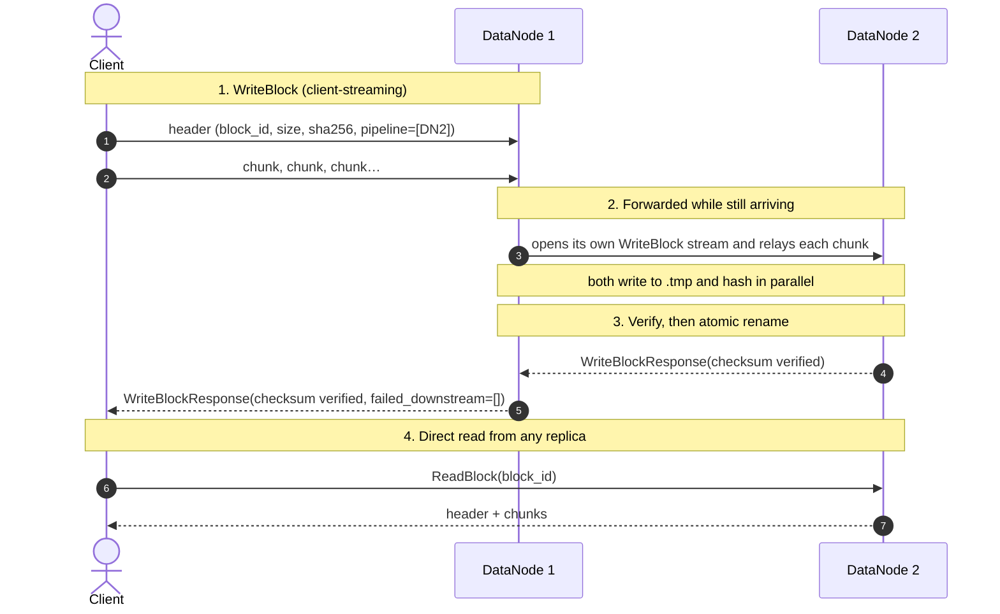

# DFSha — Data Plane: gRPC BlockService and Pipeline Replication

Implementation notes for the **data plane**: the gRPC service the DataNodes expose, how a block travels along a write pipeline, and how to run and test it. The contract this must obey is [`API.md`](API.md) Section 6 (if they disagree, `API.md` wins); the design rationale is in [`ARCHITECTURE.md`](ARCHITECTURE.md) Section 2 and Section 7.

Code: `proto/block_service.proto`, `server/nodes/datanode/`.

---

## 1. Overview

Block bytes never pass through the NameNode. It only hands the client a block plan and an ordered chain of DataNodes (the **pipeline**); the client and the DataNodes move the bytes between themselves.



---

## 2. The contract

`BlockService` exposes four RPCs:

| RPC | Type | Status |
|---|---|---|
| `WriteBlock` | client-streaming | implemented, with pipeline forwarding |
| `ReadBlock` | server-streaming | implemented for ranged reads |
| `StatBlock` | unary | implemented; returns size and whole-block SHA-256 |
| `Health` | unary | implemented |

`WriteBlockRequest` uses a `oneof payload`: the **first message must be a `WriteBlockHeader`** (`block_id`, `size`, `checksum_sha256`, `pipeline`), and every message after it carries a `bytes chunk`. `ReadBlockResponse` works the same way, with a `ReadBlockHeader` first.

`pipeline` holds the `internal_addr` of the nodes that **still** have to receive the block, so each node pops itself off and passes the rest downstream. It is empty on the last node.

**Generated stubs are not committed** (`ARCHITECTURE.md` Section 10). Generate them before running anything:

```powershell
python -m grpc_tools.protoc -I. --python_out=. --grpc_python_out=. proto/block_service.proto
```

---

## 3. Integrity guarantees

1. **Atomic persistence.** Chunks are written to `<storage>/<block_id>.tmp`. Only after the checksum matches is the file renamed with `os.replace` to `<block_id>.dat`, so a half-written block is never visible under its real name.
2. **Independent verification per node.** Because a node relays chunks before it has seen the whole block, each node computes its own SHA-256 and compares it against the header. A mismatch deletes the temporary file and aborts with `INVALID_ARGUMENT`; a corrupted stream is rejected by every node and stored by none.
3. **Pipeline tolerance.** A node checks pipeline availability before consuming the input stream, skips unavailable hops, and forwards to the first reachable node. If that hop fails during transfer, it replays the local disk-backed copy to the next hop without buffering the entire block in memory. Failed addresses are returned in `failed_downstream`.
4. **Immutable idempotency.** Per-block async locks serialize writes. A matching existing block returns `already_existed=true`; a different size or checksum is rejected. A `.sha256` sidecar caches whole-block metadata so ranged reads only seek/read the requested range.

---

## 4. Running it

Commands run from the repository root so the `server`, `proto` and `tests` packages resolve. Activate the environment first:

```powershell
.venv\Scripts\Activate.ps1
```

### Automated test

The multi-node scenario is covered by a self-contained suite that starts the DataNodes in-process on free ports:

```powershell
python -m pytest tests/integration/test_block_replication.py -v
```

### Manual cluster (for the demo)

Two DataNodes, each in its own terminal:

```powershell
python -m server.nodes.datanode --id dn1 --port 9001 --storage ./data/dn1
python -m server.nodes.datanode --id dn2 --port 9002 --storage ./data/dn2
```

Expected on startup:

```text
[DataNode dn1] Servidor gRPC activo en 127.0.0.1:9001 (Almacenamiento: ./data/dn1)
```

Send a block to `dn1` with `pipeline=["127.0.0.1:9002"]` and both `./data/dn1/<block_id>.dat` and `./data/dn2/<block_id>.dat` appear, with identical contents.

---

## 5. Remaining gaps

Tracked here so the gaps against `API.md` Section 6 are explicit:

Section references are to [`API.md`](API.md) unless stated otherwise.

| Gap | Why it matters | Reference |
|---|---|---|
| TLS on the block channel (channels are insecure today) | Encryption in transit | Section 2.3 |
| `x-block-token` validation in a server interceptor | Any client can currently read or write any block | Section 2.1 |
| AES-256-GCM encryption at rest | Encryption in storage | Section 2.3 |
| Mutual TLS between DataNodes | Node-to-node identity | Section 2 |
| REST calls to the NameNode: `register`, `heartbeat`, `block-report`, `block-received`, `block-corrupt` | Without these the NameNode cannot count replicas, detect dead nodes or order repairs | Section 7 |
| Server reflection for `grpcurl` in development | Debuggability | Section 6.5 |
