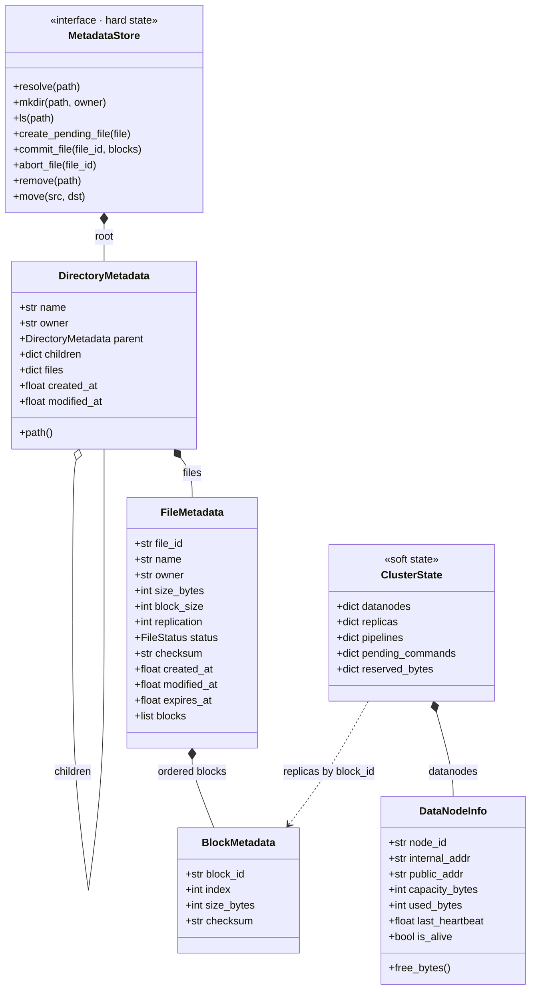

# DFSha — NameNode Metadata Models (v0.5)

Code-level reference for `server/nodes/namenode/models.py`. It complements [`ARCHITECTURE.md`](ARCHITECTURE.md) (Section 5 explains the design, this file gives the Python shape) and follows the contract in [`API.md`](API.md). If they disagree, `API.md` wins for what crosses the wire and `ARCHITECTURE.md` wins for design.

Replaces the earlier Spanish document "Documentación de Modelos de Metadatos del NameNode". Everything that document described is kept; what changed is listed in Section 8.

---

## 1. Overview

The NameNode never touches file bytes. It manages three things, and the models are split accordingly:

| Layer | What it holds | Where it lives | Classes |
|---|---|---|---|
| **Hard state** | Namespace, files, blocks, checksums, ownership, status | PostgreSQL (source of truth); leader keeps a cache in memory | `DirectoryMetadata`, `FileMetadata`, `BlockMetadata` behind `MetadataStore` |
| **Soft state** | Which DataNodes are alive, free space, which node holds which replica, pending commands | Leader memory only; rebuilt from register / heartbeats / block reports | `DataNodeInfo`, `ClusterState` |
| **Value types** | Enums and constants | Code | `FileStatus` |

Rule of thumb: if losing it on a NameNode crash would lose user data or visible structure, it is hard state. If DataNodes can tell us again within a minute, it is soft state.



`replicas` and `pipelines` are **not** fields of `BlockMetadata` in this version: they are soft state, so they live in `ClusterState` keyed by `block_id`. This keeps a `BlockMetadata` row identical to its PostgreSQL row and makes it impossible to persist replica locations by accident. (If the team prefers the convenience of `block.replicas`, keep them as fields but mark them `repr=False, compare=False` and never write them to the database; the store must ignore them.)

---

## 2. Conventions

- All models are `@dataclass`. Mutable defaults always use `field(default_factory=...)`; a bare `= []` or `= {}` is a bug (shared between instances).
- Timestamps are **UTC wall-clock** `float` seconds since epoch (`time.time()`), because they are persisted. Liveness checks use a **monotonic** clock kept separately (`last_seen_monotonic` in `ClusterState`), never `time.time()`, so clock jumps cannot kill nodes.
- Ids are opaque strings. Nobody except the NameNode parses them.
- Addresses are `host:port` (no scheme): gRPC targets, as in `API.md` Section 1.
- Sizes are in bytes (`int`).
- Models contain data and tiny derived helpers only. Rules (placement, quorum, re-replication) live in the NameNode core (`ARCHITECTURE.md` Sections 4.3 and 6).

---

## 3. Value types

```python
class FileStatus(str, Enum):
    PENDING = "PENDING"      # upload reserved; invisible to ls/get; has expires_at
    COMMITTED = "COMMITTED"  # visible and immutable (WORM)
    ABORTED = "ABORTED"      # cancelled or expired; kept briefly, then garbage collected
```

Allowed transitions: `PENDING → COMMITTED`, `PENDING → ABORTED`. Nothing leaves `COMMITTED` except deletion of the file (which removes the row and queues its blocks in `pending_deletes`). `ABORTED` is terminal.

---

## 4. Hard-state models

### 4.1 `BlockMetadata`

One fragment of a file.

| Field | Type | Description |
|---|---|---|
| `block_id` | `str` | Opaque id assigned by the NameNode, e.g. `blk_7b0c9e0e_0000`. Unique across the DFS |
| `index` | `int` | Position inside the file (`0, 1, 2…`). The file is rebuilt in this order |
| `size_bytes` | `int` | Real size. Every block is `block_size` except possibly the last one |
| `checksum` | `Optional[str]` | SHA-256 hex of the **plaintext** block. `None` while `PENDING`; set at `commit` |

Invariants:
- `0 <= size_bytes <= file.block_size`.
- Within a file, indexes are exactly `0..n-1` with no gaps.
- `n = max(1, ceil(file.size_bytes / file.block_size))`; an empty file has one block of size 0.

### 4.2 `FileMetadata`

The whole logical file.

| Field | Type | Description |
|---|---|---|
| `file_id` | `str` | Unique id assigned at `put` (UUID vs prefixed id is open decision in `ARCHITECTURE.md` Section 16) |
| `name` | `str` | Name inside its directory. The full path is computed from the parent chain |
| `owner` | `str` | Username from the authenticated principal |
| `size_bytes` | `int` | Declared size; verified against the sum of block sizes at `commit` |
| `block_size` | `int` | Block size used for **this** file (config can change later without breaking old files) |
| `replication` | `int` | Target replication factor for this file (default `REPLICATION_FACTOR`) |
| `status` | `FileStatus` | See Section 3 |
| `checksum` | `Optional[str]` | Optional SHA-256 of the whole file |
| `created_at` | `float` | UTC epoch seconds |
| `modified_at` | `float` | UTC epoch seconds |
| `expires_at` | `Optional[float]` | Only for `PENDING`: now + `UPLOAD_TTL_S`. `None` once committed |
| `blocks` | `list[BlockMetadata]` | Ordered by `index` |

Invariants:
- `(parent, name)` is unique among committed and pending entries of a directory.
- `status == COMMITTED` ⇒ `expires_at is None` and every block has a `checksum`.
- `sum(b.size_bytes for b in blocks) == size_bytes` once committed.

`path` is deliberately **not** a stored field. Use `store.path_of(file)`. See Section 5.

### 4.3 `DirectoryMetadata`

A node in the tree.

| Field | Type | Description |
|---|---|---|
| `name` | `str` | `""` for the root, otherwise a single path segment (no `/`) |
| `owner` | `str` | Owner (root is owned by `"system"`) |
| `parent` | `Optional[DirectoryMetadata]` | `None` only for the root |
| `children` | `dict[str, DirectoryMetadata]` | Subdirectories **keyed by name** |
| `files` | `dict[str, FileMetadata]` | Files **keyed by name** |
| `created_at`, `modified_at` | `float` | UTC epoch seconds |

Keying by name gives O(1) lookup and enforces name uniqueness structurally. A name cannot appear in both `children` and `files` of the same directory.

In PostgreSQL the tree is stored flat as `inodes(id, parent_id, name, kind, owner, …)` with `UNIQUE(parent_id, name)`; the in-memory tree is built from it when a NameNode becomes leader.

### 4.4 `MetadataStore`

The interface through which the NameNode core reads and writes **hard state**. Two implementations:

| Implementation | Use |
|---|---|
| `PostgresMetadataStore` | Durable metadata when `POSTGRES_DSN` is configured. Writes use transactions; an optional `LeaderGuard` fences them against a holder, term and unexpired lease. Issue 06 wires this to HA. |
| `InMemoryMetadataStore` | Unit tests only (fake time, no database) |

Responsibilities:
- Create the root (`/`, owner `system`) if it does not exist.
- Resolve absolute paths, `mkdir`, `ls`, `move`, `remove`.
- `create_pending_file`, `commit_file`, `abort_file` (atomic: all blocks and the status change in one transaction).
- Maintain the **leader-side cache** and its indexes:

| Index | Type | Purpose |
|---|---|---|
| `files_by_id` | `dict[str, FileMetadata]` | `commit`, `abort`, `tokens` |
| `files_by_path` | `dict[str, FileMetadata]` | `get`, `stat`, `rm` without walking the tree |
| `blocks_by_id` | `dict[str, BlockMetadata]` | `block-received` and block reports |

Cache rules: updated in the same call that writes the database, **after** the commit succeeds; `files_by_path` entries must be rewritten for the whole subtree on `move` and removed on `remove`; on a leadership change the cache is dropped and reloaded with `load_snapshot()`. Until issue 06 connects lease takeover, this reload is an explicit store operation rather than automatic failover.

`MetadataStore` does **not** hold the DataNode registry. That was in the first version of `models.py` and moves to `ClusterState` (Section 6).

---

## 5. Why `name` + parent instead of `path`

If every directory and file stored its full path, moving a directory would require rewriting the path of all descendants, in memory and in the database. With `name` and `parent`, `mv` changes one reference (one `UPDATE inodes SET parent_id, name`). The computed path is built by walking `parent` up to the root. The `files_by_path` index is a cache and is the only place full paths are stored.

---

## 6. Soft-state models

### 6.1 `DataNodeInfo`

| Field | Type | Description |
|---|---|---|
| `node_id` | `str` | Stable id the DataNode registers with |
| `internal_addr` | `str` | `host:port` used by **other DataNodes** (pipeline, re-replication) |
| `public_addr` | `str` | `host:port` given to **clients** |
| `capacity_bytes` | `int` | Total storage reported |
| `used_bytes` | `int` | Used storage from the last heartbeat |
| `last_heartbeat` | `float` | UTC wall clock, informational |
| `last_seen_monotonic` | `float` | `time.monotonic()` at the last heartbeat; **used for liveness** |
| `is_alive` | `bool` | Set by `monitor_datanodes` after `DEAD_NODE_TIMEOUT_S` without a heartbeat |

Derived: `free_bytes() = max(0, capacity_bytes - used_bytes)`.
(The earlier `address` field is split into `internal_addr` / `public_addr`, see `API.md` Section 1.)

### 6.2 `ClusterState`

Everything the leader learns from DataNodes. Lost on failover by design; rebuilt within roughly one heartbeat plus `FAILOVER_GRACE_S`.

| Field | Type | Description |
|---|---|---|
| `datanodes` | `dict[str, DataNodeInfo]` | Registry by `node_id` |
| `replicas` | `dict[str, set[str]]` | `block_id → node_ids` that **confirmed** a valid copy (via `block-received` or block report) |
| `pipelines` | `dict[str, list[str]]` | `block_id → ordered node_ids` **allocated** for an upload. Allocation, not confirmation |
| `pending_commands` | `dict[str, list[Command]]` | `node_id → commands` (`replicate`, `delete`) delivered in the next heartbeat response |
| `replica_checksums` | `dict[str, dict[str, str]]` | `block_id → {node_id → checksum}` each confirming node computed. `commit` compares it with the checksum the client sent, which a bare set of ids cannot do |
| `in_flight_replications` | `dict[str, dict[str, float]]` | `block_id → {target node_id → monotonic start}` being copied, so the same block is not scheduled twice and a copy that never finishes can time out |
| `reserved_bytes` | `dict[str, int]` | `node_id → bytes` promised to uploads and copies in progress; subtracted from free space by placement |
| `reservations` | `dict[str, dict[str, int]]` | `block_id → {node_id → bytes}` still held. Tracked per pair so a reservation is released **exactly once** however it ends (confirmed, committed, aborted, timed out, node died). Deriving it from `pipelines` minus `replicas` would release twice when a replica is later lost |

Pipeline vs replicas is the key distinction: a block with 3 nodes in `pipelines` and 2 in `replicas` has been written to 2 nodes so far. `commit` succeeds when `len(replicas[block]) >= MIN_REPLICAS_COMMIT` for **every** block, counting only replicas on live nodes whose checksum equals the client's.

**Where the reservation is released.** The earlier draft released it when a heartbeat "covered" the space. The code releases it at the precise event instead: when that node confirms the block, when the upload commits (unconfirmed hops never arrive), when it is aborted or expires, or when a copy times out or its target dies. A heartbeat cannot know which blocks it accounts for, so releasing on heartbeats either leaks space or frees it too early.

Concurrency: all mutations happen on the event loop or under one lock; background tasks iterate over **snapshots** (`list(d.items())`), never the live dict (`ARCHITECTURE.md` Section 4.4).

---

## 7. Mapping to the API and the database

| Model | `API.md` object | PostgreSQL |
|---|---|---|
| `FileMetadata` | file entries in `ls` / `stat`, `prepare` / `commit` | `files` + `inodes` |
| `DirectoryMetadata` | directory entries | `inodes` (`kind='dir'`) |
| `BlockMetadata` | block list in `get` / `prepare` responses | `blocks` |
| replicas (soft) | `locations` in the `get` response, built from `ClusterState.replicas` + `public_addr` | none (rebuilt from block reports) |
| pipeline (soft) | `pipeline` in the `prepare` / `tokens` response, built from `internal_addr` | none |
| `DataNodeInfo` | register / heartbeat payloads | none |

Note what goes to the client: block locations use `public_addr`; the pipeline inside the write header uses `internal_addr` (`API.md` Sections 1 and 6.2).

---

## 8. Changes from the original model document and `models.py`

| # | Original | Now | Reason |
|---|---|---|---|
| 1 | Spanish | English | Team decision: all documents in English |
| 2 | `FileMetadata` had `file_id`, `path`, `size_bytes`, `blocks` | Adds `name`, `owner`, `block_size`, `replication`, `status`, `checksum`, `created_at`, `modified_at`, `expires_at`; drops stored `path` | Needed by the upload protocol (`PENDING`/`COMMITTED`/`ABORTED`, TTL), ACLs and cheap `mv` |
| 3 | `DirectoryMetadata` had `path`, `children: list`, `files: list` | `name`, `children: dict`, `files: dict`, timestamps | O(1) lookup, name uniqueness by construction, cheap `mv` |
| 4 | `BlockMetadata.replicas: list[str]` | Moved to `ClusterState.replicas` (set of node_ids); allocation tracked separately in `pipelines` | Replica locations are soft state; confirmed copies ≠ allocated pipeline |
| 5 | `MetadataStore` held `datanodes` | `ClusterState` holds them | Keeps the persisted interface limited to hard state |
| 6 | `DataNodeInfo.address` | `internal_addr` + `public_addr` + monotonic `last_seen_monotonic` | gRPC block channel, clients vs DataNodes, clock safety |
| 7 | `@dataclass` and indexes listed as "future recommendations" | Mandatory (Sections 2 and 4.4) | Avoids shared-mutable-default bugs; indexes are required for block reports |
| 8 | In-memory only | `MetadataStore` interface with PostgreSQL as the real implementation; in-memory fake for tests | High availability is part of the design from the start (`ARCHITECTURE.md` Section 5.2) |

Open points that still affect these models are tracked in `ARCHITECTURE.md` Section 16 (namespace per user vs ACL sharing, `file_id` format).

---

## 9. Authentication and access-control state

Authentication data is a separate hard-state boundary, implemented by
`AuthStore` alongside (not inside) `MetadataStore`. This keeps credentials,
API keys, groups, ACLs and audit events out of the namespace persistence
interface, while allowing issue 03 to provide a PostgreSQL implementation
without coupling those records to block and inode operations. The current
`InMemoryAuthStore` is for tests and development only; production persistence
is deferred to issue 03.

| Model | Stored fields | Purpose |
|---|---|---|
| `User` | username, Argon2 password hash, role, creation time, TOTP-enabled flag | Authentication and future MFA branch |
| `ApiKey` | key id, owning username, name, SHA-256 digest of the 256-bit random key, creation/revocation times | Revocable long-lived credentials; plaintext is returned only once |
| `Group` | name, owner username, member usernames | Group-based ACL matching |
| `AclEntry` | canonical path, `user:<name>` / `group:<name>` subject, permission | Path ACL stored at the path where it is set |
| `AuditEntry` | timestamp, user, operation, path, result, optional request id | Append-only audit hook for auth and filesystem decisions |

`Permission` is ordered `NONE < READ < READ_WRITE`. The owner of the exact
file or directory always has `READ_WRITE`; there is no implicit admin bypass
for filesystem ACLs. ACL lookup unions matching user/group grants along the
ancestor chain. A `none` at a more-specific path masks grants inherited from
further ancestors; a grant on a child path can conversely override an ancestor
`none`. Multiple entries applying at the same path are unioned unless one of
them is `none`, in which case `none` denies at that specificity. The REST
adapter must set the authenticated request principal before calling core
operations; absent principals are rejected rather than treated as a trusted
system user.

The core's request-scoped principal context is only an adapter convenience;
explicit `user` arguments take precedence. Auth records and group membership
are returned as snapshots so a caller cannot mutate the store by changing a
returned object. API-key material is generated with 256 bits of randomness, so
its SHA-256 digest is used for indexed lookup rather than a slow password hash;
passwords themselves use Argon2id through `argon2-cffi`.
