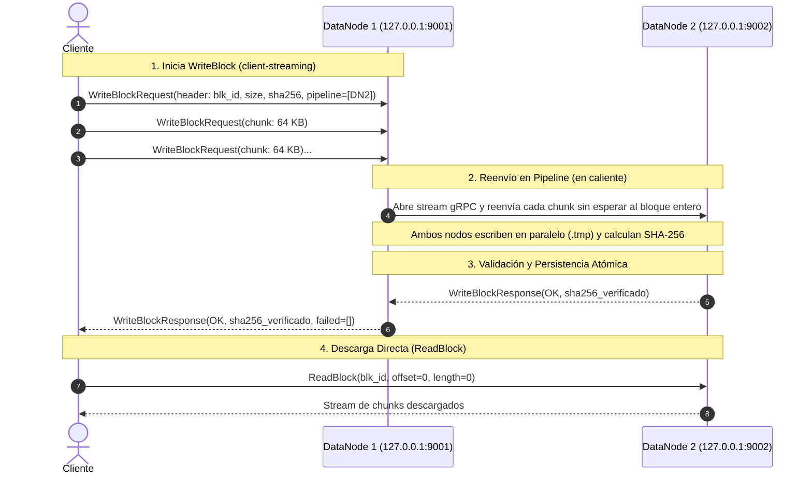

# Plano de Datos: gRPC BlockService y Replicación en Pipeline

Este documento describe la arquitectura técnica, el contrato Protocol Buffers y el procedimiento de ejecución y prueba para el **Plano de Datos (Data Plane)** de DFSha.

---

## 1. Visión General del Plano de Datos

En DFSha, el almacenamiento y la transferencia de bytes físicos se delegan íntegramente a los **DataNodes** mediante **gRPC**. 

El NameNode nunca recibe ni reenvía el contenido de los archivos; únicamente entrega al cliente un plan de bloques y una cadena de nodos ordenada (**pipeline**). El cliente y los DataNodes se encargan de la transmisión y replicación punto a punto.



---

## 2. Contrato Protocol Buffers (`proto/block_service.proto`)

El servicio `BlockService` expone 4 RPCs:

```protobuf
service BlockService {
  rpc WriteBlock(stream WriteBlockRequest) returns (WriteBlockResponse);
  rpc ReadBlock(ReadBlockRequest) returns (stream ReadBlockResponse);
  rpc StatBlock(StatBlockRequest) returns (StatBlockResponse);
  rpc Health(HealthRequest) returns (HealthResponse);
}
```

### Estructura de Mensajes Clave:
* **`WriteBlockRequest`**: Utiliza un patrón `oneof payload`:
  * El primer mensaje de la transmisión **debe ser `WriteBlockHeader`** (`block_id`, `size`, `checksum_sha256`, `pipeline`).
  * Los mensajes posteriores transmiten los bytes en pedazos **`bytes chunk`** (64 KB).
* **`WriteBlockResponse`**: Devuelve `block_id`, `size`, el hash `checksum_sha256` verificado y la lista `failed_downstream` en caso de que algún nodo subsiguiente en la cadena haya fallado.
* **`ReadBlockResponse`**: Envía un `ReadBlockHeader` inicial con el tamaño total y luego un flujo de `bytes chunk`.

---

## 3. Garantías de Consistencia e Integridad

1. **Escritura Atómica en Disco:**  
   Los chunks se escriben en un archivo temporal (`data/{node_id}/{block_id}.tmp`).
2. **Verificación Estricta de Checksum:**  
   Al cerrar el stream, el nodo calcula el SHA-256 acumulado y lo compara con el recibido en el header.
   * Si no coincide: el archivo temporal se elimina y la RPC se aborta con `StatusCode.INVALID_ARGUMENT`.
   * Si coincide: el archivo temporal se renombra atómicamente (`os.replace`) a `data/{node_id}/{block_id}.dat`. Nunca queda un archivo a medio escribir visible en el disco.
3. **Tolerancia en Pipeline:**  
   Si un nodo downstream en la cadena falla, el nodo actual completa su almacenamiento local y reporta la dirección caída en `failed_downstream`, permitiendo que el NameNode programe la reparación después.

---

## 4. Guía de Ejecución y Pruebas

Para evitar conflictos de imports entre paquetes, los comandos deben ejecutarse desde la **raíz del proyecto (`DFS`)** usando el flag de módulo **`-m`**.

### Requisitos Previos:
Tener el entorno virtual activo:
```powershell
.venv\Scripts\Activate.ps1
```

Si se modifica el archivo `.proto`, recompilar con:
```powershell
python -m grpc_tools.protoc -I. --python_out=. --grpc_python_out=. proto/block_service.proto
```

---

### Procedimiento para la Prueba de Replicación:

Abre **3 terminales independientes** en la raíz del proyecto:

#### Terminal 1 — Iniciar DataNode 1 (Puerto 9001):
```powershell
python -m server.nodes.datanode --id dn1 --port 9001 --storage ./data/dn1
```
*Salida esperada:*
```text
[DataNode dn1] Servidor gRPC activo en 127.0.0.1:9001 (Almacenamiento: ./data/dn1)
```

#### Terminal 2 — Iniciar DataNode 2 (Puerto 9002):
```powershell
python -m server.nodes.datanode --id dn2 --port 9002 --storage ./data/dn2
```
*Salida esperada:*
```text
[DataNode dn2] Servidor gRPC activo en 127.0.0.1:9002 (Almacenamiento: ./data/dn2)
```

#### Terminal 3 — Ejecutar el Test de Replicación en Pipeline:
```powershell
python -m tests.test_replication
```

*Salida exitosa:*
```text
============================================================
INICIANDO PRUEBA DE REPLICACIÓN gRPC (PIPELINE)
============================================================

[TEST] Bloque generado:
  - ID: blk_test_001
  - Tamaño: 67000 bytes
  - SHA-256: dcfb1c1f77dabb92d8aebd244a24d66c1e9b046bfc832781153dd52cc51757e9

[TEST] Enviando bloque a 127.0.0.1:9001 con pipeline hacia [127.0.0.1:9002]...

[TEST] Respuesta recibida de DN1:
  - Bloque: blk_test_001
  - Bytes escritos: 67000
  - Checksum confirmado: dcfb1c1f77dabb92d8aebd244a24d66c1e9b046bfc832781153dd52cc51757e9
  - Fallos en downstream: []

[TEST] Verificando réplica en 127.0.0.1:9002 con ReadBlock...
  - Bytes leídos desde DN2: 67000
  - Checksum leído desde DN2: dcfb1c1f77dabb92d8aebd244a24d66c1e9b046bfc832781153dd52cc51757e9

============================================================
>>> PRUEBA EXITOSA: Bloque replicado y verificado en DN2! <<<
============================================================
```

### Verificación en Disco:
Tras la prueba, puedes comprobar que el bloque físico existe en las dos carpetas:
* `./data/dn1/blk_test_001.dat`
* `./data/dn2/blk_test_001.dat`
