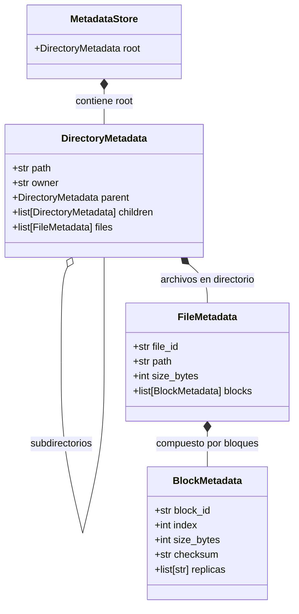

# Documentación de Modelos de Metadatos del NameNode

Este documento describe las estructuras de datos y modelos base definidos en [`server/namenode/models.py`] para el **ControlNode / NameNode**.

---

## 1. Visión General del Diseño

El NameNode actúa como el cerebro del sistema de archivos distribuido (DFS). En lugar de manipular los bytes brutos de los archivos, administra la jerarquía lógica del sistema de archivos (árbol de directorios), el mapeo de archivos a bloques lógicos y la ubicación física de las réplicas en los **DataNodes**.

Para mantener una representación en memoria clara y desacoplada, el modelo se divide en tres niveles fundamentales:
1. **Bloques (`BlockMetadata`)**: Fragmentos discretos en los que se divide un archivo.
2. **Archivos (`FileMetadata`)**: Entidad lógica compuesta por una secuencia ordenada de bloques.
3. **Directorios y Jerarquía (`DirectoryMetadata` & `MetadataStore`)**: Árbol jerárquico tipo UNIX con raíz `/` para organizar archivos y carpetas.

---

## 2. Descripción de Modelos

### A. [`BlockMetadata`]
Representa un fragmento o chunk individual de un archivo distribuido.

| Campo | Tipo | Descripción |
|---|---|---|
| `block_id` | `str` | Identificador único opaco asignado por el NameNode (ej. `blk_7b0c9e0e_000000`). |
| `index` | `int` | Índice de posición del bloque dentro del archivo (`0, 1, 2...`). Permite reensamblar el archivo en el orden exacto. |
| `size_bytes` | `int` | Tamaño real del bloque en bytes (típicamente hasta `BLOCK_SIZE`). |
| `checksum` | `Optional[str]` | Checksum SHA-256 en hexadecimal del contenido en texto claro para verificar integridad contra corrupción. |
| `replicas` | `list[str]` | Lista de identificadores de nodos (`node_id` de DataNodes) que confirman almacenar una copia física válida de este bloque. |

---

### B. [`FileMetadata`]
Representa el archivo lógico completo dentro del DFS.

| Campo | Tipo | Descripción |
|---|---|---|
| `file_id` | `str` | Identificador único global (UUID) asignado durante la reserva de subida (`put`). |
| `path` | `str` | Ruta canónica y absoluta del archivo dentro del DFS (ej. `/documentos/datos.csv`). |
| `size_bytes` | `int` | Tamaño total del archivo en bytes. |
| `blocks` | `list[BlockMetadata]` | Lista ordenada de bloques que conforman el archivo. |

---

### C. [`DirectoryMetadata`]
Modela un nodo de directorio dentro de la estructura de árbol jerárquica del sistema de archivos.

| Campo | Tipo | Descripción |
|---|---|---|
| `path` | `str` | Ruta absoluta del directorio (ej. `/`, `/proyectos`). |
| `owner` | `str` | Usuario propietario del directorio (para control de accesos y permisos). |
| `parent` | `Optional[DirectoryMetadata]` | Referencia al directorio padre (`None` en el caso del directorio raíz `/`). |
| `children` | `list[DirectoryMetadata]` | Lista de subdirectorios contenidos en esta ruta. |
| `files` | `list[FileMetadata]` | Lista de archivos contenidos directamente en este directorio. |

---

### D. [`MetadataStore`]
El administrador del estado y espacio de nombres (*namespace*) del NameNode en memoria.

- **Inicialización:** Inicializa automáticamente el directorio raíz (`/`) asignándole propietario `"system"`.
- **Propósito:** Ofrece el punto de entrada para navegar el árbol, resolver rutas absolutas, crear directorios (`mkdir`), listar contenidos (`ls`) y registrar la llegada de réplicas desde los DataNodes.

---

## 3. Notas de Implementación y Recomendaciones Futuras

1. **Decorador `@dataclass`:**
   En [`BlockMetadata`] y [`FileMetadata`] actualmente se usan anotaciones de tipo a nivel de clase. Conviene agregar `@dataclass` (o inicializador `__init__`) y usar `field(default_factory=list)` para evitar problemas de lista mutable compartida entre instancias en `replicas`.
2. **Índices de Búsqueda Rápida ($O(1)$):**
   Además de la navegación por árbol, es recomendable que [`MetadataStore`] mantenga diccionarios secundarios `files_by_path: dict[str, FileMetadata]` y `blocks_by_id: dict[str, BlockMetadata]` para responder a peticiones de lectura y reportes de bloques sin recorrer el árbol completo.
